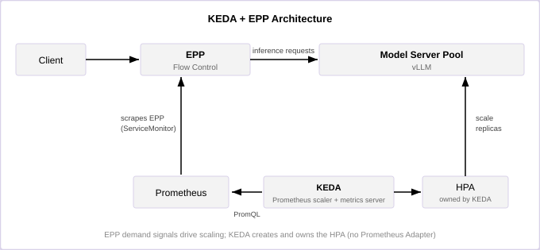

# 结合 EPP 指标的 KEDA

端点选择器（EPP）与 KEDA 的集成利用来自 EPP 的需求侧信号来扩缩模型服务器副本。KEDA 不依赖粗粒度的资源利用率，而是从 Prometheus 查询 EPP 指标，通过其指标服务器暴露计算后的扩缩器取值，并创建一个消费这些外部指标的 HPA。这种方式非常适合同构部署，即每个目标模型服务器池都可以通过指标隔离并独立扩缩。

这是 llm-d 中推荐的自动扩缩容路径。[WVA 路径](./wva.md)已弃用。

## 功能 {#functionality}

KEDA+EPP 集成提供：

- **需求驱动的扩缩**：根据 EPP 信号——队列深度、活跃请求数、资源池饱和度、进行中的 token 数或预估延迟——增加或移除副本，这些信号反映的是推理需求而不是加速器利用率。
- **标准的 Kubernetes 执行机制**：KEDA 管理一个 `autoscaling/v2` HPA，因此 HPA 的状态和行为仍然可以通过标准 Kubernetes API 查看。
- **可选的缩容到零**：流量空闲时，KEDA 可以移除所有模型服务器副本，并在 EPP 流量控制队列中有请求时重新激活 Deployment。
- **无需自定义控制器，也无需 Prometheus Adapter**：整个回路只有 KEDA、Prometheus 和一个 `ScaledObject`。

## 设计 {#design}

### LLM 自动扩缩容问题 {#the-llm-autoscaling-problem}

在活跃的 token 生成期间，无论模型服务器是轻载还是饱和，GPU 利用率都可能保持在高位。基于利用率的自动扩缩器无法可靠地区分空闲的服务容量与过载的批次。

EPP 流量控制把超出的需求转移到网关，在终端用户延迟恶化之前就能在那里测量到它。EPP 把这些需求暴露为可以直接映射到扩缩决策的指标——响应式的饱和信号（排队请求）、前瞻式的并发信号（运行中请求、进行中 token）以及相对于目标的信号（资源池饱和度、相对 SLO 的预估延迟）。

### 架构 {#architecture}

### 扩缩流水线 {#scaling-pipeline}

扩缩流水线如下：

1. **指标输出**：EPP 在其指标端点上暴露指标（例如 `llm_d_epp_flow_control_queue_size` 和 `llm_d_epp_request_running`）。
2. **指标采集**：Prometheus 通过路由器的 `ServiceMonitor` 抓取 EPP。
3. **指标计算**：KEDA 的 Prometheus 扩缩器为每个触发器计算一个标量或单元素的 PromQL 结果。也可以选择用 `spec.advanced.scalingModifiers` 把多个触发器组合成一个公式。
4. **指标发布**：KEDA 通过其指标服务器把计算出的扩缩器取值暴露给 Kubernetes External Metrics API。
5. **扩缩决策**：KEDA 生成的 HPA 计算期望副本数，并对目标 Deployment 进行调谐。

用户创建的是一个 `ScaledObject`，而不是第二个 HPA。多个 HPA 指向同一个 Deployment 会相互冲突。

Prometheus Adapter 不属于这条流水线，因为 KEDA 的 Prometheus 扩缩器直接查询 Prometheus。Prometheus Adapter 路径已弃用。

### 扩缩信号 {#scaling-signals}

上述流水线与具体信号无关：各条可部署路径之间的差别，在于触发器读取哪些 EPP 指标以及阈值如何推导。

| 信号 | EPP 指标 | 阈值的含义 | 指南 |
|---|---|---|---|
| **队列深度** | `llm_d_epp_flow_control_queue_size`、`llm_d_epp_request_running` | 每副本的绝对目标值，需按部署调优 | [keda-epp（队列信号）](https://github.com/llm-d/llm-d/tree/v0.10.0/guides/workload-autoscaling/keda-epp) |
| **资源池饱和度** | `llm_d_epp_flow_control_pool_saturation`、`llm_d_epp_request_running` | 归一化比率（0.0–1.0+），在不同硬件间更具可移植性 | [keda-epp（饱和度信号）](https://github.com/llm-d/llm-d/tree/v0.10.0/guides/workload-autoscaling/keda-epp#choosing-a-scaling-signal) |
| **Token 积压** | `llm_d_epp_inflight_tokens`、每个 Pod 的 KV 缓存占用 | prefill 队列等待的秒数，由 TTFT SLO 的一部分和校准后的 `peakPrefillThroughput` 推导 | [keda-epp-token-aware](https://github.com/llm-d/llm-d/tree/v0.10.0/guides/workload-autoscaling/keda-epp-token-aware) |
| **预估延迟** | EPP 预测/实际的 TTFT 和 TPOT 直方图 | 延迟 ÷ SLO，带迟滞区间 | [slo-aware](https://github.com/llm-d/llm-d/tree/v0.10.0/guides/workload-autoscaling/slo-aware) |

队列深度和资源池饱和度是对未满足需求的计数，介于滞后与领先之间。之所以存在 token 积压信号，是因为按请求数计算时，一个 8192 token 的提示词与一个 512 token 的提示词被同等对待，而它们的 prefill 工作量相差 16 倍。预估延迟直接针对目标本身而不是其代理指标进行扩缩；其控制律的推导见[基于 KEDA 的 SLO 感知自动扩缩容](./slo-aware-keda.md)。

### 双指标策略 {#dual-metric-strategy}

这些路径大多配置两个而不是一个触发器，以便同时体现未满足的需求和活跃并发。基于队列的路径是典型示例：

| 指标 | 信号 | KEDA 指标类型 | 含义 |
|---|---|---|---|
| EPP 流量控制队列大小 | 未满足的需求 | `AverageValue` | 每个模型服务器副本的目标排队请求总量 |
| 运行中请求数 | 活跃并发 | `AverageValue` | 每个模型服务器副本的目标进行中请求数 |

每个 `AverageValue` 阈值都是每副本的目标值。对于每个指标，HPA 根据总量和目标值计算出期望副本数；粗略地说，总量必须超过 `阈值 × 当前副本数` 才会扩容到当前数量之上。当所有配置的指标都可用时，Kubernetes 采用其中最大的期望副本数。

SLO 感知路径是个例外：它把各触发器合并为单个 `scalingModifiers` 公式，其输出*就是*期望副本数，对应的目标值是直接透传的 `1`。当触发器需要以算术方式组合、而不是彼此“比大小”时，请使用这种形式。

### 待调度与预热中的 Pod {#pending-and-warming-pods}

触发器就是一条 PromQL 查询，因此并不局限于 EPP 的序列：`ScaledObject` 还可以从 kube-state-metrics 读取目标的副本数，并对已预配但尚未提供服务的容量——处于 Pending、正在调度或仍在加载模型的 Pod——进行推理。

SLO 感知路径就是这么做的。它同时读取 `kube_deployment_status_replicas`（已预配，`n`）和 `kube_deployment_status_replicas_ready`（已就绪，`r`），并在扩容分支上用在途抵扣 `r/n` 折减其需求。由于延迟信号只在就绪的 Pod 上测量，在扩容进行中时这些 Pod 会高估预热完成后的负载；抵扣使每次扩容请求只覆盖已在路上的 Pod 之外的缺口，而不是在还没有 Pod 就绪时就冲向 `maxReplicas`。推导请参阅[基于 KEDA 的 SLO 感知自动扩缩容](./slo-aware-keda.md)。

较简单的按指标 `AverageValue` 路径不包含这一项。在这些路径中，是 HPA 自身的稳定窗口和扩容策略在防止调度缓慢的资源池过度扩容。

### 共享紧张的加速器预算 {#sharing-a-contended-accelerator-budget}

每个 `ScaledObject` 都基于自己的信号扩缩自己的 Deployment，因此共享同一 GPU 预算的两个资源池可能同时扩容，合计申请的加速器数超过实际存在的数量。这个问题不在自动扩缩容回路中解决，也不需要在那里解决：准入属于调度问题，由下一层的 [Kueue](https://kueue.sigs.k8s.io/) 处理。

每个副本 Pod 都会成为一个 Kueue `Workload`，在有可用配额之前被挡在调度闸门处。每个模型在共享 cohort 中获得一个有保障的 GPU 下限，把自己暂不使用的部分借给其他模型，并在自身需求回升时通过抢占收回自己的下限。HPA 不做任何改动，也不加注解，因此 KEDA 仍然独占它所生成的 HPA，上面的自动扩缩容配置也保持不变：超出预算的副本只是保持 Pending，直到配额释放。

请参阅[基于 Kueue 的副本再平衡指南](https://github.com/llm-d/llm-d/tree/v0.10.0/guides/workload-autoscaling/kueue-rebalancing)。它取代了实验性的副本再平衡器（已在 #2498 中移除）——后者从 HPA *之上*通过修改带注解 HPA 的 `maxReplicas` 来执行同样的预算，而这种方式需要 KEDA 不会传递的 HPA 注解。两者绝不能同时运行。

### 指标隔离 {#metric-isolation}

每条 PromQL 查询都聚合为一个值，并且必须隔离出与目标 Deployment 关联的 EPP/InferencePool。`namespace`、`model_name` 和 `inference_pool` 等标签的取值取决于部署和抓取配置。运行中请求数指标不暴露 `inference_pool`。由于多个资源池可能提供同一个模型，选择器可能还需要 `service` 等 EPP 抓取标签。请对照线上的 Prometheus 序列验证隔离是否正确。

### 所有权与扩缩行为 {#ownership-and-scaling-behavior}

在 `ScaledObject` 的整个生命周期内，KEDA 拥有其生成的 HPA：

- KEDA 评估触发器的激活状态，并负责从零到一的激活。
- 生成的 HPA 负责在 1 到 N 个副本之间扩缩。
- `cooldownPeriod` 控制缩容到零；当最小副本数为 1 或以上时，它不控制普通的 HPA 缩容。
- `ScaledObject.spec.advanced.horizontalPodAutoscalerConfig.behavior` 会被复制到生成的 HPA，控制稳定窗口和扩缩策略。
- 删除 `ScaledObject` 会移除生成的 HPA，但不会删除目标 Deployment。

### 缩容到零 {#scale-to-zero}

在没有任何模型服务器端点就绪时，EPP 流量控制会缓冲请求，从而支持从零扩容。排队的请求会推高队列大小指标，KEDA 随之激活目标 Deployment，EPP 则在模型服务器就绪后分发该请求。

只有在验证了 1 到 N 的扩缩之后，才应启用缩容到零。模型冷启动时间会变成请求延迟，客户端必须留出足够的时间让模型加载。

### 局限性 {#limitations}

- **不支持跨变体放置。**每个 `ScaledObject` 依据自己的指标扩缩一个 Deployment。在不同硬件上提供同一模型的多个资源池各自独立扩缩，彼此之间没有成本感知的偏好。
- **不支持按成本选择硬件。**自动扩缩器只会为它所指向的变体申请更多副本；它不会判断某些需求由更便宜的加速器来服务更好。在资源池之间共享紧张的加速器预算*已经*有解决方案，但位于自动扩缩器之下——参见[共享紧张的加速器预算](#sharing-a-contended-accelerator-budget)。
- **每次扩容都要付出预热代价。**模型加载和 torch-compile 时间横亘在决策与容量之间。缩短 Pod 就绪时间通常是收益最高的调优手段；参见[基于 KEDA 的 SLO 感知自动扩缩容](./slo-aware-keda.md)中讨论的预热补丁。

## 部署指南 {#deployment-guides}

请从[工作负载自动扩缩容指南](https://github.com/llm-d/llm-d/tree/v0.10.0/guides/workload-autoscaling)开始，其中涵盖了上表中每种信号的可复用路由器配置值、`ScaledObject`、认证说明和验证步骤。
