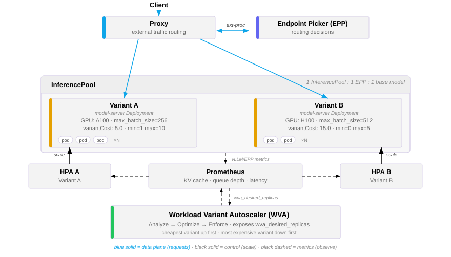
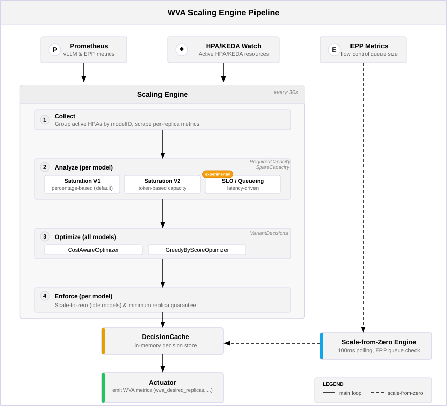

# Workload Variant Autoscaler（WVA）——已弃用

:::warning
**已弃用。**Workload Variant Autoscaler 已被弃用，不再是推荐的 llm-d 工作负载自动扩缩容方式。此处保留它作为现有部署的设计参考；不会再增加新功能，请规划迁移。

推荐的路径是[结合 EPP 指标的 KEDA](./keda-epp.md)，通过[工作负载自动扩缩容指南](https://github.com/llm-d/llm-d/tree/v0.10.0/guides/workload-autoscaling)进行部署。请参阅下文的[从 WVA 迁移](#migrating-off-wva)。

在已弃用的路径内部，`VariantAutoscaling`（VA）CRD 本身也已被消费 WVA 所发布 `wva_desired_replicas` 指标的 HPA 对象取代——参见[从 VA 迁移到 HPA + WVA](#migration-from-va-to-hpa--wva)。
:::


## 功能 {#functionality}

Workload Variant Autoscaler（WVA）既是优化器，也是 Kubernetes 控制器，它根据实时的资源利用率和性能指标自动扩缩 LLM 推理工作负载。作为优化器，它分析所有 InferencePool 变体的供需信号，做出全局成本最优的扩缩决策。作为控制器，它通过管理模型服务部署（Deployment、StatefulSet 或 LeaderWorkerSet）的副本数来调谐这些决策，并观测通过 Prometheus 抓取的 vLLM 指标。

WVA 具有**变体感知**能力。**变体（variant）**是 InferencePool 中多个模型服务器之一，它们都提供同一个基础模型，但在硬件配置（例如 GPU 类型）、服务配置（例如张量并行、最大批大小、量化）或两者上有所不同，并各自有对应的成本。WVA 在这些变体之间进行优化，在满足容量或延迟要求的同时最小化总成本。

:::note
WVA 假定 InferencePool、端点选择器（EPP）和基础模型之间是 1:1:1 的关系。一个 InferencePool 内的所有变体共享同一个 EPP，因此也共享相同的 EPP 指标（例如请求队列大小）。
:::


WVA 提供两种主要的扩缩分析器：

- **饱和度分析器（Saturation Analyzer）**——根据资源饱和信号（KV 缓存利用率、请求队列深度和 token 级容量）进行扩缩。当系统检测到模型服务器饱和（KV 缓存空间不足或队列堆积）时，会在最便宜的可用变体上触发扩容。当检测到有空闲容量时，会缩容最昂贵的变体。这是默认的分析器。它有两个子变体：`saturation-percentage-based`（默认）和 `saturation-token-based`（实验性）。

:::note
这两个子变体也被称为 **V1**（`saturation-percentage-based`）和 **V2**（`saturation-token-based`）饱和度引擎。[HPA + WVA 指南](https://github.com/llm-d/llm-d/tree/v0.10.0/guides/workload-autoscaling/wva)、WVA 配置键以及控制器日志（例如 `V2 saturation analysis completed`）使用 V1/V2 的名称；本文对相同的引擎使用更具描述性的 `saturation-percentage-based` / `saturation-token-based` 名称。
:::


- **SLO 分析器（排队模型）** *（实验性）*——基于排队论，依据延迟 SLO 目标进行扩缩。它使用卡尔曼滤波器在线学习特定于硬件的性能参数，然后应用一个状态相关的马尔可夫排队模型，确定在满足目标 TTFT（首 token 时间）和 ITL（token 间延迟）的前提下每个副本可持续承受的最大请求速率。期望副本数按观测到的到达速率与该容量之比计算。

两种分析器都集成在一条流水线中，该流水线包括成本感知优化、缩容到零的执行，以及可选的 GPU 资源限制。

## 设计 {#design}

### 与 llm-d 组件的关系 {#relation-to-llm-d-components}

下图展示了 WVA 在 llm-d 整体架构中的位置：



### 扩缩引擎架构 {#scaling-engine-architecture}

WVA 扩缩引擎作为一个后台 goroutine，与 Kubernetes 控制器一起运行。每个周期，它按 `modelID` 对处于活跃状态、由 WVA 管理的 HPA 分组，抓取每个副本的指标，并把它们送入下面的流水线。决策写入一个内存中的决策缓存，再由执行器（actuator）据此输出供 HPA 消费的 `wva_desired_replicas` 外部指标。

:::note
该引擎同时支持 `saturation-percentage-based` 和 `saturation-token-based` 两种分析路径。`saturation-percentage-based` 是默认值。`saturation-token-based` 是一种实验性的基于 token 的方法，尚未达到生产可用。这里描述的架构涵盖了两条流水线。
:::


主循环每 30 秒运行一次，遵循四阶段流水线模式：



**流水线各阶段：**

1. **采集（Collect）**——按 `modelID` 对处于活跃状态、由 WVA 管理的 HPA 分组，并为得到的每个 InferencePool 抓取每个副本的指标（来自 Prometheus；对于 EPP 流量控制队列，则直接从 EPP 获取）。

2. **分析（Analyzer）**——每个分析器为每个 InferencePool 生成容量信号（所需容量、空闲容量）和一个优先级分数。分析器不直接做扩缩决策；它只量化需要多少容量或可以释放多少容量。

3. **优化（Optimizer）**——优化器接收扩缩请求（每个 InferencePool 一个），并生成变体决策，为每个变体指定目标副本数。有两种模式：
   - **成本感知**（默认，不受限模式）：独立处理每个 InferencePool。扩容成本效率最高的变体；缩容最昂贵的变体。
   - **按分数贪心**（受限模式，`enableLimiter: true`）：根据优先级分数，在所有 InferencePool 之间公平分配可用的 GPU 资源。

4. **执行（Enforcer）**——应用优化后的策略：当某个 InferencePool 空闲（保留期内没有请求）时缩容到零；或者在禁用缩容到零时，强制保持最少副本数（在最便宜的变体上至少保留 1 个副本）。

得到的变体决策被写入内存中的**决策缓存**，由**执行器**将其发布为 `wva_desired_replicas` 外部指标。另有一个独立的**从零扩容引擎**每 100 毫秒轮询一次 EPP 流量控制队列，并直接写入同一个决策缓存，使空闲的 InferencePool 无需等待 30 秒的主循环即可扩容。

### 饱和度分析器 {#saturation-analyzer}

饱和度分析器根据 InferencePool 的饱和程度确定扩缩需求。

#### `saturation-percentage-based`——默认 {#saturation-percentage-based----default}

`saturation-percentage-based` 分析器在两个维度上使用百分比阈值：

- **KV 缓存利用率**——如果 KV 缓存使用率达到或超过阈值（默认 0.80），该副本即为饱和。
- **队列长度**——如果队列长度达到或超过阈值（默认 5），该副本即为饱和。

当平均空闲 KV 容量低于空闲触发值（默认 0.10），或平均空闲队列容量低于队列空闲触发值（默认 3）时，触发扩容。它会在最便宜的变体上增加 1 个副本，并跳过有待就绪副本的变体。

当至少存在 2 个未饱和的副本，并且模拟 N/(N-1) 的负载重新分配后仍有足够余量时，缩容才是安全的。它会从最昂贵的变体上移除 1 个副本。

当任何变体处于过渡状态（期望副本数 != 当前副本数）时，`saturation-percentage-based` 会阻止所有扩缩。

#### `saturation-token-based`——实验性 {#saturation-token-based----experimental}

`saturation-token-based` 分析器使用绝对 token 数而不是百分比，从而能够跨变体比较容量，实现更精确的扩缩。

每个副本的容量用两个上限建模：

- **k1（内存受限）**：以 token 计的 KV 总容量乘以 KV 缓存阈值——即 KV 缓存能容纳多少 token。
- **k2（计算受限）**：按以下优先级链确定：
  1. **观测值**：当队列饱和（队列长度达到或超过阈值）时，直接取当前正在使用的 token 数。
  2. **历史值**：先前观测值的滚动平均（窗口大小 10）。
  3. **根据部署参数推导**：使用稳态批处理模型，根据有效的最大批处理 token 数、最大序列数以及平均输入/输出 token 长度计算。
  4. **兜底**：k1（仅考虑内存）。

每个副本的**有效容量**取 k1 与 k2 的最小值。每个变体的容量取所有就绪副本的中位数进行汇总。

每个副本的**需求**等于当前正在使用的 token 数，加上排队请求数乘以平均输入 token 长度。EPP 队列需求（来自 `llm_d_epp_flow_control_queue_size` 和 `llm_d_epp_flow_control_queue_bytes` 指标）会被加到 InferencePool 级的总量中。

扩缩信号：

- **所需容量**：总需求除以扩容阈值，再减去预期供给。正值表示需要扩容。
- **空闲容量**：总供给减去“总需求除以缩容边界”。正值表示可以缩容。

默认阈值：扩容阈值 0.85，缩容边界 0.70。

相比 `saturation-percentage-based` 的主要改进：

- token 级粒度使跨变体、跨 InferencePool 的容量比较成为可能
- 双上限容量模型（内存 + 计算）同时捕捉两种资源瓶颈
- 为零副本的变体缓存容量信息，使扩容前就能进行准确的成本估算
- 支持 P/D（Prefill/Decode）分离，并按角色归属容量
- 考虑 EPP 队列需求（在到达任何 vLLM Pod 之前就已排队的请求）
- 按输出长度对计算受限历史进行工作负载分桶（短 < 100、中 < 500、长 >= 500 个 token）

### SLO 分析器（排队模型）——实验性 {#slo-analyzer-queueing-model----experimental}

SLO 分析器依据延迟目标而不是资源饱和度进行扩缩。当存在 `wva-queueing-model-config` ConfigMap 时它就会被激活。

该分析器分三个阶段运行：

1. **在线参数学习（Tuner）**——使用卡尔曼滤波器从观测到的指标中学习三个特定于硬件的参数：
   - **alpha**：基础迭代开销（毫秒）
   - **beta**：每 token 的计算时间（毫秒）
   - **gamma**：每 token 的 KV 缓存内存访问时间（毫秒）

   Tuner 根据每个副本的指标（到达速率、平均输入/输出 token 数、平均 TTFT、平均 ITL）构建环境快照，并运行卡尔曼滤波器估计这些参数。

2. **确定 SLO 目标**——两种方式：
   - **显式**：来自 ConfigMap（`targetTTFT`、`targetITL`，单位为毫秒）。
   - **推断**（默认）：使用空闲延迟乘数法。用预测的空闲延迟（基于 alpha、beta、gamma 和平均 token 长度）乘以 SLO 乘数 k（默认 3.0，对应约 0.67 的目标利用率），推导出目标 TTFT 和 ITL。
   - **兜底**：观测到的 TTFT/ITL 乘以 1.5 倍余量，并设定合理的上限。

3. **容量计算**——使用 M/M/1/k 排队论模型，计算在满足 SLO 目标前提下每个副本的最大请求速率。期望副本数等于总到达速率除以该最大速率，向上取整。

SLO 分析器使用的指标：

- `llm_d_epp_scheduler_attempts_total{status="success"}`——每个 Pod 的到达速率（请求/秒）
- `vllm:time_to_first_token_seconds`——TTFT 直方图（用 sum/count 求平均）
- `vllm:time_per_output_token_seconds`——ITL 直方图（用 sum/count 求平均）
- `vllm:request_generation_tokens`——平均输出 token 数（sum/count）
- `vllm:request_prompt_tokens`——平均输入 token 数（sum/count）

### 缩容到零与从零扩容 {#scale-to-and-from-zero}

#### 缩容到零 {#scale-to-zero}

缩容到零由**执行（Enforcer）**流水线阶段处理，它在优化器生成扩缩决策之后运行。

对于每个 InferencePool：

1. 检查是否启用了缩容到零（按 InferencePool 配置 > 全局 ConfigMap 默认值 > `WVA_SCALE_TO_ZERO` 环境变量 > false）。
2. 如果启用，则为该 InferencePool 查询 `sum(increase(vllm:request_success_total{...}[retentionPeriod]))`。
3. 如果在保留期内（默认 10 分钟）请求数为 0，则把所有变体的目标副本数设为 0。
4. 如果禁用了缩容到零，则确保最便宜的变体上至少有 1 个副本。

当任何变体在 VA spec 中设置了 `MinReplicas > 0` 时，会完全跳过缩容到零。

#### 从零扩容 {#scale-from-zero}

从零扩容作为一个独立的引擎运行，使用 100 毫秒的快速轮询间隔，与 30 秒的主饱和度引擎循环相互独立。这确保了对空闲 InferencePool 收到的请求能够快速响应。

对于每个副本数为 0 的 VA：

1. 从数据存储中找到匹配的 InferencePool。
2. 向 EPP（端点选择器）指标来源查询 `llm_d_epp_flow_control_queue_size{target_model_name=<modelID>}`。
3. 如果队列大小 > 0（存在待处理请求），则直接把部署扩容到 1 个副本。
4. 记录扩缩决策并触发控制器调谐。

从零扩容引擎以可配置的最大并发度并行处理不活跃的 VA。

## 指标采集 {#metric-collection}

WVA 通过一个来源注册表采集指标，该注册表保存具名的指标来源实现。使用两类来源：

- **Prometheus 来源**——在启动时注册。执行 PromQL 查询以获取模型服务器指标（KV 缓存利用率、队列深度、延迟等）。
- **Pod 抓取来源**——在发现 InferencePool 资源时动态添加。当一个新资源池被写入数据存储时，WVA 会创建一个专用的 Pod 抓取来源，并用该资源池的 EPP 服务名、命名空间和指标端口进行配置。这些来源用于直接从 Pod（而不是通过 Prometheus）采集 EPP 级指标（例如流量控制队列大小）。当关联的资源池被删除时，这些来源会被自动移除。

每个指标来源提供三项主要能力：

- 返回查询注册表，用于注册查询模板
- 执行查询并更新缓存
- 按给定参数获取某条查询的缓存值

### 已注册的查询 {#registered-queries}

**饱和度查询**（按 Pod，1 分钟窗口）：

| 查询名称 | PromQL | 用途 |
|---|---|---|
| `kv_cache_usage` | `max by (pod) (max_over_time(vllm:kv_cache_usage_perc{...}[1m]))` | KV 缓存利用率（0-1） |
| `queue_length` | `max by (pod) (max_over_time(vllm:num_requests_waiting{...}[1m]))` | 待处理请求队列深度 |
| `cache_config_info` | `max by (pod, num_gpu_blocks, block_size) (vllm:cache_config_info{...})` | KV 缓存配置（总容量） |
| `avg_output_tokens` | `rate(vllm:request_generation_tokens_sum[5m]) / rate(..._count[5m])` | 平均输出 token 数 |
| `avg_input_tokens` | `rate(vllm:request_prompt_tokens_sum[5m]) / rate(..._count[5m])` | 平均输入 token 数 |
| `prefix_cache_hit_rate` | `rate(vllm:prefix_cache_hits[5m]) / rate(vllm:prefix_cache_queries[5m])` | 前缀缓存命中率 |
| `scheduler_queue_size` | `sum(llm_d_epp_flow_control_queue_size{...})` | 上游 EPP 队列深度 |
| `scheduler_queue_bytes` | `sum(llm_d_epp_flow_control_queue_bytes{...})` | 上游 EPP 队列字节数 |

**排队模型查询**（按 Pod，1 分钟窗口）：

| 查询名称 | PromQL | 用途 |
|---|---|---|
| `scheduler_dispatch_rate` | `sum by (endpoint_name) (rate(llm_d_epp_scheduler_attempts_total{status="success",...}[1m]))` | 每个 Pod 的到达速率 |
| `avg_ttft` | `rate(vllm:time_to_first_token_seconds_sum[1m]) / rate(..._count[1m])` | 平均首 token 时间 |
| `avg_itl` | `rate(vllm:time_per_output_token_seconds_sum[1m]) / rate(..._count[1m])` | 平均 token 间延迟 |

**缩容到零查询**：

| 查询名称 | PromQL | 用途 |
|---|---|---|
| `model_request_count` | `sum(increase(vllm:request_success_total{...}[retentionPeriod]))` | 保留窗口内的请求总数 |

**从零扩容**直接使用 EPP（端点选择器）指标（不经过 Prometheus）：

| 指标 | 用途 |
|---|---|
| `llm_d_epp_flow_control_queue_size` | EPP 流量控制队列中的待处理请求数 |

副本指标采集器负责编排查询的执行，并填充每个 Pod 的指标数据供分析器使用。

## VariantAutoscaling（VA）对象 {#the-variantautoscaling-va-object}

VariantAutoscaling（简称 `va`）是核心 CRD，表示单个 InferencePool 变体的自动扩缩容配置。API 组：`llmd.ai/v1alpha1`。

### Spec

| 字段 | 类型 | 默认值 | 说明 |
|---|---|---|---|
| `scaleTargetRef` | 对象引用 | （必填） | 对可扩缩资源（Deployment、StatefulSet 或 LeaderWorkerSet）的引用 |
| `modelID` | string | （必填） | 把该 VA 关联到某个 InferencePool 的唯一标识符；取值相同的所有 VA 组成一个变体组 |
| `minReplicas` | integer | `1` | 副本数下限。设为 `0` 以启用缩容到零 |
| `maxReplicas` | integer | `2` | 副本数上限 |
| `variantCost` | string | `"10.0"` | 该变体每个副本的成本（用于成本感知优化） |

校验规则：`minReplicas <= maxReplicas`。

### Status

| 字段 | 类型 | 说明 |
|---|---|---|
| `desiredOptimizedAlloc.numReplicas` | integer | 优化引擎给出的目标副本数 |
| `desiredOptimizedAlloc.lastRunTime` | timestamp | 最近一次优化运行的时间戳 |
| `desiredOptimizedAlloc.accelerator` | string | *（已弃用）*加速器类型 |
| `actuation.applied` | boolean | 扩缩决策是否已成功应用 |
| `conditions` | 条件列表 | 可观测的状态条件 |

### Conditions

| 类型 | 说明 |
|---|---|
| `TargetResolved` | 是否找到了扩缩目标（Deployment/LWS） |
| `MetricsAvailable` | 是否能从 Prometheus 获取 vLLM 指标 |
| `OptimizationReady` | 优化引擎是否成功运行 |

### 多变体 InferencePool 示例 {#multi-variant-inferencepool-example}

具有相同 `modelID` 的多个 VA 对象表示同一个 InferencePool 的不同变体，各自运行在不同的硬件上。优化器会把所有变体放在一起考虑：

```yaml
# 变体 1：高性价比 GPU
apiVersion: llmd.ai/v1alpha1
kind: VariantAutoscaling
metadata:
  name: llama-8b-a10g
spec:
  scaleTargetRef:
    apiVersion: apps/v1
    kind: Deployment
    name: llama-8b-a10g
  modelID: "meta/llama-3.1-8b"
  minReplicas: 1
  maxReplicas: 10
  variantCost: "5.0"
---
# 变体 2：高性能 GPU
apiVersion: llmd.ai/v1alpha1
kind: VariantAutoscaling
metadata:
  name: llama-8b-a100
spec:
  scaleTargetRef:
    apiVersion: apps/v1
    kind: Deployment
    name: llama-8b-a100
  modelID: "meta/llama-3.1-8b"
  minReplicas: 0
  maxReplicas: 5
  variantCost: "15.0"
```

## 配置 {#configuration}

WVA 使用分层配置系统。配置来源按以下优先级解析：**命令行参数 > 环境变量 > 配置文件 > ConfigMap > 默认值**。

ConfigMap 提供动态的运行时配置，必须带有标签 `app.kubernetes.io/name: workload-variant-autoscaler`。系统会监视其变化并动态重新加载。命名空间内的 ConfigMap 会覆盖全局 ConfigMap，从而支持按命名空间调优。

### 扩缩引擎配置 {#scaling-engine-configuration}

#### 总体架构 {#general-architecture}

引擎通过 `wva-saturation-scaling-config` ConfigMap 配置。该 ConfigMap 控制使用哪种分析器、扩缩决策的阈值以及优化器模式。

#### 饱和度分析器配置 {#saturation-analyzer-configuration}

`wva-saturation-scaling-config` ConfigMap 控制饱和度分析器的行为。支持使用 `model_id` 和 `namespace` 字段按 InferencePool 覆盖配置。

```yaml
apiVersion: v1
kind: ConfigMap
metadata:
  name: wva-saturation-scaling-config
  labels:
    app.kubernetes.io/name: workload-variant-autoscaler
data:
  default: |
    # 分析器选择：留空或省略表示 saturation-percentage-based / V1（默认），
    # "saturation" 表示 saturation-token-based / V2（实验性）。
    analyzerName: "saturation"

    # saturation-percentage-based 阈值（analyzerName 为 "" 或省略时使用）
    kvCacheThreshold: 0.80        # KV 缓存饱和阈值（0-1）
    queueLengthThreshold: 5       # 队列深度饱和阈值
    kvSpareTrigger: 0.10          # 扩容触发：空闲 KV 容量低于此值
    queueSpareTrigger: 3          # 扩容触发：空闲队列容量低于此值

    # saturation-token-based 阈值（analyzerName 为 "saturation" 时使用）
    scaleUpThreshold: 0.85        # 利用率高于此值时触发扩容
    scaleDownBoundary: 0.70       # 利用率低于此值时允许缩容

    # 优化器模式
    enableLimiter: false          # false：CostAwareOptimizer，true：GreedyByScoreOptimizer
    priority: 1.0                 # GreedyByScore 使用的模型优先级（默认 1.0）

  # 按模型覆盖示例
  llama-override: |
    model_id: "meta/llama-3.1-8b"
    namespace: "llm-inference"
    scaleUpThreshold: 0.90
    scaleDownBoundary: 0.75
```

:::note
选择基于 token 的（V2）饱和度引擎有两种等价方式。上面所示的标量形式 `analyzerName: "saturation"` 是向后兼容的写法。[HPA + WVA 指南](https://github.com/llm-d/llm-d/tree/v0.10.0/guides/workload-autoscaling/wva#enabling-saturation-engine-v2-recommended)中使用的较新的列表形式与之等价：

```yaml
analyzers:
  - name: saturation
```

填写 `analyzers` 列表还可以按分析器覆盖分数和阈值。两者都省略时，会回退到基于百分比的（V1）引擎。
:::


#### SLO 分析器（排队模型）配置——实验性 {#slo-analyzer-queueing-model-configuration----experimental}

当存在一个带有 `"default"` 条目的 `wva-queueing-model-config` ConfigMap 时，SLO 分析器会被激活。启用后，它的优先级高于饱和度分析器。

```yaml
apiVersion: v1
kind: ConfigMap
metadata:
  name: wva-queueing-model-config
  labels:
    app.kubernetes.io/name: workload-variant-autoscaler
data:
  default: |
    sloMultiplier: 3.0            # k 因子（目标利用率 rho = 1 - 1/k）
    tuningEnabled: true           # 启用卡尔曼滤波器进行在线参数学习

  # 带显式 SLO 目标的按模型覆盖
  llama-slo: |
    model_id: "meta/llama-3.1-8b"
    namespace: "llm-inference"
    targetTTFT: 500               # 目标 TTFT（毫秒）
    targetITL: 100                # 目标 ITL（毫秒）
```

#### 缩容到零配置 {#scale-to-zero-configuration}

```yaml
apiVersion: v1
kind: ConfigMap
metadata:
  name: wva-model-scale-to-zero-config
  labels:
    app.kubernetes.io/name: workload-variant-autoscaler
data:
  default: |
    enable_scale_to_zero: true
    retention_period: "10m"       # 检查模型是否空闲的时间段

  # 为特定模型禁用缩容到零
  llama-override: |
    model_id: "meta/llama-3.1-8b"
    enable_scale_to_zero: false
```

### 指标采集配置 {#metric-collection-configuration}

Prometheus 连接通过统一配置进行设置：

| 设置项 | 来源 | 默认值 | 说明 |
|---|---|---|---|
| Prometheus URL | 配置文件 / 命令行 | -- | Prometheus API 的基础 URL |
| TLS 配置 | 配置文件 | -- | 连接 Prometheus 所用的 TLS 证书 |

### VA 对象配置 {#va-object-configuration}

VA 对象本身是面向用户的主要配置入口。完整的 spec 参考请参阅 [VA 对象一节](#the-variantautoscaling-va-object)。

每个 VA 的关键配置决策：

- **`minReplicas: 0`** 为该变体启用缩容到零。
- **`variantCost`** 决定扩缩的偏好顺序：较便宜的变体先扩容，较昂贵的变体先缩容。
- 具有相同 **`modelID`** 的多个 VA 组成一个 InferencePool 的变体组，一起进行优化。

### 命令行参数 {#cli-flags}

控制器的关键参数：

| 参数 | 默认值 | 说明 |
|---|---|---|
| `--config-file` | -- | 配置文件路径 |
| `--metrics-bind-address` | `:8080` | 指标端点绑定地址 |
| `--health-probe-bind-address` | `:8081` | 健康探针绑定地址 |
| `--leader-elect` | `false` | 启用 leader 选举以实现高可用 |
| `--watch-namespace` | -- | 限定在单个命名空间内 |
| `--leader-election-lease-duration` | `60s` | leader 选举租约时长 |
| `--leader-election-renew-deadline` | `50s` | leader 选举续约截止时间 |
| `--rest-client-timeout` | `60s` | Kubernetes API 客户端超时 |

## 从 WVA 迁移 {#migrating-off-wva}

WVA 已弃用；迁移目标是 [KEDA + EPP 路径](./keda-epp.md)。由于两种设计表达扩缩意图的方式不同，因此没有自动转换：WVA 为每个变体全局计算一个期望副本数，而 KEDA + EPP 则依据各自的 EPP 信号扩缩每个 Deployment。

迁移步骤：

1. 从[信号表](./keda-epp.md#scaling-signals)中选择与你的工作负载匹配的信号——队列深度、资源池饱和度、token 积压或预估延迟——并按照相应指南为每个模型服务器 Deployment 创建一个 `ScaledObject`。
2. 在创建 `ScaledObject` *之前*，删除由 WVA 管理的 HPA（带有 `llm-d.ai/managed: "true"` 的 HPA），如果你仍在使用 VA 形式，则删除 `VariantAutoscaling` 对象。KEDA 会生成自己的 HPA，两个 HPA 指向同一个 Deployment 会发生冲突。
3. 卸载 WVA 控制器；如果 Prometheus Adapter 是专为 WVA 安装的、且没有其他组件使用它，也一并卸载。

迁移会失去跨变体的成本感知放置——即选择在更便宜的硬件上满足需求；参见[局限性](./keda-epp.md#limitations)。如果你的部署依赖这一能力，请暂时继续使用 WVA，并关注自动扩缩容指南以获取替代方案。

在资源池之间共享紧张的加速器预算*并不*需要 WVA：请使用[基于 Kueue 的副本再平衡](https://github.com/llm-d/llm-d/tree/v0.10.0/guides/workload-autoscaling/kueue-rebalancing)，它在 HPA 之下按每个模型的配额下限对副本 Pod 进行门控，因此可以与任何 KEDA + EPP 信号组合使用。

## 从 VA 迁移到 HPA + WVA {#migration-from-va-to-hpa--wva}

:::note
本节为历史内容。它记录的是在现已弃用的 WVA 路径*内部*，从 `VariantAutoscaling` CRD 迁移到 WVA 发布指标的过程。新部署应改用 [KEDA + EPP](./keda-epp.md)。
:::


[HPA + WVA](https://github.com/llm-d/llm-d/tree/v0.10.0/guides/workload-autoscaling/wva) 方式用标准的 Kubernetes HPA 对象取代了 `VariantAutoscaling`（VA）CRD，这些 HPA 消费 WVA 发布的 `wva_desired_replicas` 外部指标。这样就无需管理 VA 资源，并使扩缩意图通过标准的 `kubectl get hpa` 可见。

### 主要区别 {#key-differences}

| | VA（已被取代） | HPA + WVA（已弃用） |
|---|---|---|
| **扩缩对象** | `VariantAutoscaling` CRD | 标准 `HorizontalPodAutoscaler` |
| **扩缩目标** | 由 WVA 通过 VA spec 中的 `scaleTargetRef` 管理 | 由 HPA 通过标准的 `scaleTargetRef` 管理 |
| **WVA 发现方式** | WVA 监视 `VariantAutoscaling` 资源 | WVA 通过 `llm-d.ai/managed: "true"` 注解发现 HPA |
| **扩缩指标** | WVA 直接设置副本数 | WVA 发布 `wva_desired_replicas`；HPA 据此执行 |
| **CRD 要求** | 需要 `llmd.ai/v1alpha1` `VariantAutoscaling` CRD | 不需要自定义 CRD |
| **可观测性** | `kubectl get va` | `kubectl get hpa` |

### 迁移步骤 {#migration-steps}

1. 为每个要迁移的部署**删除现有的 VA 对象**：

   ```bash
   kubectl delete va <va-name> -n <namespace>
   ```

:::note
删除 VA 对象后，WVA 将不再管理该部署的副本数。如果需要避免中断，请在删除 VA 之前手动把部署扩缩到期望的副本数。
:::


2. **创建 HPA 对象**，并加上 `llm-d.ai/managed: "true"` 注解。WVA 会发现这些 HPA，并发布带有 `variant_name` 和 `exported_namespace` 标签的 `wva_desired_replicas`：

   ```yaml
   apiVersion: autoscaling/v2
   kind: HorizontalPodAutoscaler
   metadata:
     name: <deployment-name>
     namespace: <namespace>
     annotations:
       llm-d.ai/managed: "true"
   spec:
     scaleTargetRef:
       apiVersion: apps/v1
       kind: Deployment
       name: <deployment-name>
     minReplicas: 1
     maxReplicas: <max>
     metrics:
       - type: External
         external:
           metric:
             name: wva_desired_replicas
             selector:
               matchLabels:
                 variant_name: <deployment-name>
                 exported_namespace: <namespace>
           target:
             type: AverageValue
             averageValue: "1"
   ```

   之前在 VA 上设置的 `variantCost` 可以作为注解保留：`llm-d.ai/variant-cost: "<cost>"`。WVA 会读取该注解，以在各变体之间保留成本感知优化。

3. **验证** WVA 已发现该 HPA 并在发布指标：

   ```bash
   kubectl get hpa <deployment-name> -n <namespace>
   kubectl get --raw "/apis/external.metrics.k8s.io/v1beta1/namespaces/<namespace>/wva_desired_replicas" | jq .
   ```

4. 在所有 VA 都已迁移且 HPA 运行正常后，**删除 VA CRD**：

   ```bash
   kubectl delete crd variantautoscalings.llmd.ai
   ```

包括 Prometheus Adapter 和 WVA 控制器安装在内的完整端到端配置流程，请参阅 [HPA + WVA 指南](https://github.com/llm-d/llm-d/tree/v0.10.0/guides/workload-autoscaling/wva)。
