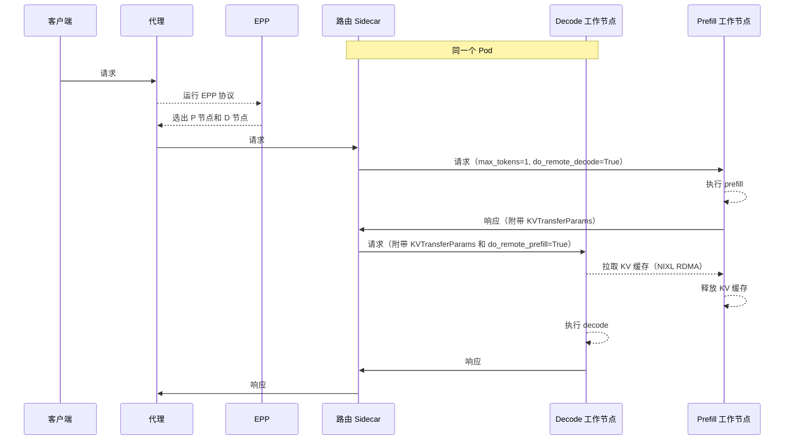
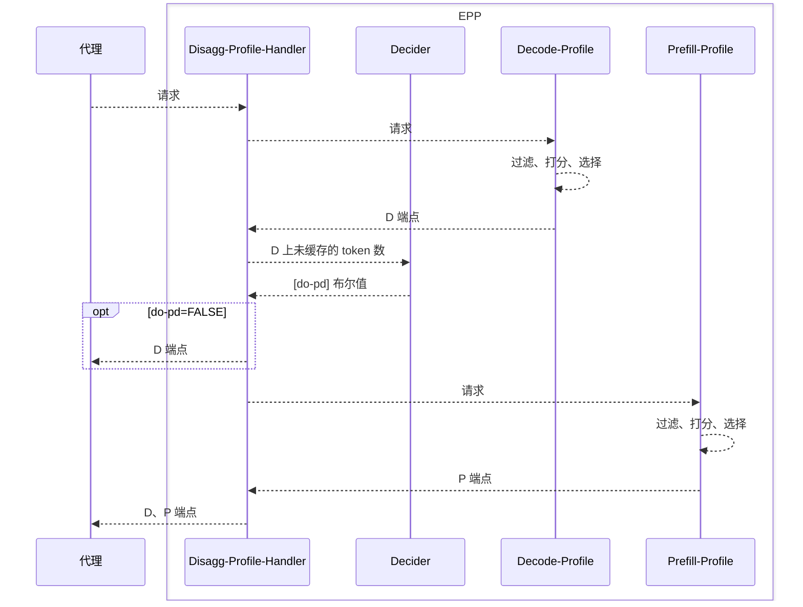

# 分离式服务

## 功能 {#functionality}

分离式服务把 LLM 推理的 **prefill** 和 **decode** 阶段放到不同的模型服务器实例上，从而实现：

* **P 与 D 的专门化**——LLM 推理由两个截然不同的阶段组成：prefill（受算力限制）和 decode（受内存带宽限制）。分离使专门化成为可能，例如在受内存限制的 decode 阶段使用更大的 TP，而在受算力限制的 prefill 阶段使用较小的 TP。
* **避免请求相互干扰**——对于长上下文请求，prefill 会拖慢处于 decode 阶段的已有请求。把这些长请求的 prefill 阶段放到专门的 prefill 实例上，可以让进行中的 decode 请求高效处理，不被长 prefill 阻塞，从而提升服务质量。
* **与 DP/EP 兼容**——对于混合专家（MoE）模型的 DP/EP 部署，分离式服务对于避免流水线气泡、以及在 decode 中利用专门的“MaskedGEMM”格式至关重要。

实现分离式服务需要两个关键组件：

* **请求流编排**——选择正确的 prefill 和 decode Pod 并把请求路由过去
* **高效 KV 传输**——把 KV 缓存从 P 实例传输到 D 实例，通常通过 RDMA

:::note
分离式服务要求节点之间具备高性能（RDMA）互联，以实现高效的 KV 传输。没有 RDMA 时，NIXL 会回退到 TCP 传输，效率不高，只应用于测试和开发。
:::


## 请求流编排 {#request-flow-orchestration}

llm-d 的 EPP 通过选择一对 prefill 和 decode 工作节点来支持 P/D 分离，请求流程如下：



接下来我们讨论分离式服务中 EPP 和路由 Sidecar 的设计。

### EPP

llm-d EPP 通过 `disagg-profile-handler` 支持分离。

:::note
EPP 并没有硬编码单一的调度算法，而是把执行委托给一个或多个 `Profile Handler`，每个都代表一套完整的调度策略。可以把它们看作“调度员”：在打分器和选择器开始选择实际端点之前，先把每个推理请求映射到正确的调度策略。默认情况下，llm-d 在简单的聚合式服务中使用 `single-profile-handler`。
:::


配置了 `disagg-profile-handler` 时，EPP 按以下步骤处理请求：

* `proxy` 把请求元数据转发给 EPP。
* `disagg-profile-handler` 运行 `decode-profile`，执行 `filter`、`score`、`pick` 调度流程，选出 D 端点。
* `disagg-profile-handler` 咨询 `decider`——根据提示词在 D 上已缓存的比例，这个请求是否应该走分离路径？
* 如果`否`：`disagg-profile-handler` 只把 D 端点返回给 `proxy`
* 如果`是`（未缓存的后缀很长）：`disagg-profile-handler` 还会运行 `prefill-profile`，执行 `filter`、`score`、`pick` 调度流程选出 P 端点，并把 P 和 D 端点一起返回给代理。

流程如下：



通过这种方式，分离式服务功能与现有的调度功能组合在一起，使现有的前缀感知和负载感知路由打分器可以在分离场景中继续使用。

注意，prefill 和 decode 端点都属于同一个 `InferencePool`。`decode-profile` 和 `prefill-profile` 负责在 `filter` 步骤中只选出 D 工作节点或 P 工作节点。llm-d 使用标签 `llm-d.ai/role` 及以下取值进行过滤：

* `prefill` → 仅做 prefill 的 Pod
* `decode` → 能做 decode 的 Pod
* `prefill-decode` → 同时能做 prefill 和 decode 的 Pod

:::note
如需使用不同的标签键，请在 `prefill` 和 `decode` Profile 中，用具名的 `label-selector-filter` 插件替换针对角色的过滤器。在模型服务器 Pod 上应用相同的标签，并保持 Profile 名称为 `prefill` 和 `decode`；`disagg-profile-handler` 在选择 Profile 时会使用这些名称。
:::


### 路由代理 Sidecar {#routing-proxy-sidecar}

路由代理以 Sidecar 形式部署在每个 decode Pod 中，承担两方面的角色：

* 协调多步骤的推理请求
* 改写请求，使其遵循各模型服务器的 KV 传输协议

#### 请求流程 {#request-flow}

请求到达时，Sidecar 会检查代理设置的路由请求头：

| 请求头 | 用途 |
|---|---|
| `x-prefiller-host-port` | 一个或多个 prefill Pod 地址（逗号分隔或多值） |

根据存在哪些请求头，Sidecar 选择以下两条执行路径之一：

1. **Prefiller → Decoder（P/D）**——标准的分离路径。请求被发送到远程 prefiller，收集 KV 传输元数据，然后把补充后的请求转发给本地 decoder。
2. **仅 Decoder**——没有路由请求头；请求被直接代理到本地模型服务器实例。

所有非 completion 路由（`GET /health` 及其他任何路径）都会原样透传给 decoder。

#### KV 传输协议 {#kv-transfer-protocol}

vLLM 和 SGLang 在 P 和 D 实例之间进行 KV 传输时使用的协议略有不同，它们会在请求体中插入额外的参数以协调传输：

* **vLLM**（`nixlv2`，默认）——一个两阶段的顺序协议。Sidecar 发送一个 prefill 请求，其中 `kv_transfer_params` 包含远程 decode 元数据，并设置 `max_tokens=1` 以抑制输出。它从 prefiller 的响应中捕获 KV 传输参数，注入到 decode 请求中，再转发给本地 decoder。如果 prefiller 返回服务器错误，Sidecar 会回退到仅 decoder 模式（客户端错误不会重试）。
* **SGLang**（`sglang`）——使用并发的 prefill/decode 模型。Sidecar 不等待 prefill 完成，而是在两个请求中都注入引导协调参数（`bootstrap_host`、`bootstrap_port`、`bootstrap_room`），在一个 goroutine 中异步发起 prefill（使用 `context.WithoutCancel` 防止被过早取消），并立即同步发送 decode 请求。decoder 和 prefiller 通过 bootstrap room 在带外协调 KV 传输。

## 高效 KV 传输 {#efficient-kv-transfer}

除了协调元数据和对各实例 RPC 调用的**请求流编排**之外，高效的 **KV 传输**（把 KV 从 P 实例搬到 D 实例）对于高性能的分离式部署也至关重要。

vLLM 和 SGLang 都支持多种 KV 传输引擎——在 llm-d 中，我们目前专注于 NIXL。

### NIXL 集成 {#nixl-integration}

[NVIDIA Inference Transfer Library（NIXL）](https://github.com/ai-dynamo/nixl)用于加速 AI 推理框架中的点对点通信。

NIXL 提供在远程实例之间传输内存的标准化 API，并提供多种后端（例如 UCX、UCCL、libfabric），每种后端又支持多种底层传输方式（NVLink、RoCE、IB、EFA 等）。

|             | IB | RoCE | TCP-X | EFA |
|-------------|:--:|:----:|:-----:|:---:|
| **UCX**     | ✓  |  ✓   |       |     |
| **UCCL**    | ✓  |  ✓   |   ✓   |  ✓  |
| **libfabric**|   |      |       |  ✓  |

:::note
UCX 也支持通过 TCP 和 NVLINK 传输。TCP 非常慢，仅面向本地开发。NVLINK 传输用于本地开发，无法在 Kubernetes 部署中使用，因为它不能跨越 Pod 边界。
:::


### 直接 KV 缓存传输 {#direct-kv-cache-transfer}

vLLM 和 SGLang 都会提前为 KV 缓存预留显存。NIXL 直接注册这块 KV 缓存内存，并在 KV 缓存之间直接传输数据，从而无需额外的缓冲区和内存管理。启用 GPUDirect RDMA（GPU 显存注册到网卡）后，传输会绕过 CPU，实现高吞吐、低延迟的传输。

```
┌─────────────────────────────┐              ┌─────────────────────────────┐
│          节点 1             │              │          节点 2             │
│                             │              │                             │
│  ┌───────────────────────┐  │              │  ┌───────────────────────┐  │
│  │     Prefill Pod       │  │              │  │     Decode Pod        │  │
│  │                       │  │              │  │                       │  │
│  │  ┌─────────────────┐  │  │              │  │  ┌─────────────────┐  │  │
│  │  │ KV 缓存（显存） │  │  │              │  │  │ KV 缓存（显存） │  │  │
│  │  └────────┬────────┘  │  │              │  │  └────────┬────────┘  │  │
│  │           │           │  │              │  │           │           │  │
│  └───────────┼───────────┘  │              │  └───────────┼───────────┘  │
│              │              │              │              │              │
│              ▼              │              │              ▼              │
│  ┌───────────────────────┐  │     网络     │  ┌───────────────────────┐  │
│  │         网卡          │  │              │  │         网卡          │  │
│  │  InfiniBand / RoCE    │──┼──────────────┼──│  InfiniBand / RoCE    │  │
│  └───────────────────────┘  │              │  └───────────────────────┘  │
│                             │              │                             │
└─────────────────────────────┘              └─────────────────────────────┘
```

## 运维 {#operations}

分离式服务引入了与各模型服务器 KV 传输机制相关的运维考量：动态连接、请求取消、容错以及发布。请参阅各引擎的运维指南：

* [分离式服务：运维（vLLM）](../../../operations/disaggregation/vllm.md)
* [分离式服务：运维（SGLang）](../../../operations/disaggregation/sglang.md)
