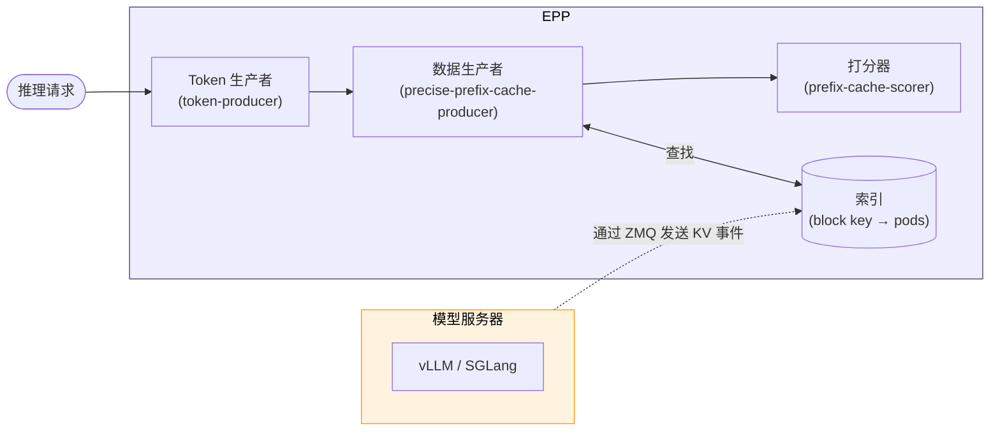

# KV 缓存索引器

**KV 缓存索引器**是 **llm-d 路由器**的一个组件（位于 **EPP** 内），它实现了精确的前缀缓存感知路由功能。

:::note
本页假定你已熟悉 EPP 的设计。更多细节请参阅 [EPP 架构](../../core/router/epp)。
:::


## 功能 {#functionality}

KV 缓存索引器订阅模型服务器发出的 `KVEvents`，维护 KV 缓存状态的近实时视图。`precise-prefix-cache-producer`（由 `prefix-cache-scorer` 使用）在 EPP 的“过滤 → 打分 → 选择”流程中使用这些信息。

对于较难近似估算的场景，精确视图能提供更高的精度：

- **多模态模型**——多模态内容（图像、音频）的哈希会被并入块键，因此文本相同但图像不同的两个提示词会产生不同的键，并被路由到持有匹配多模态 KV 缓存的 Pod。
- **混合注意力模型**——在混合模型中，各层组（全注意力、滑动窗口、线性注意力）的 KV 缓存占用呈非线性变化，使基于字节的树不够精确。
- **高级 KV 缓存编排**——随着模型服务器的 KV 缓存管理策略越来越超出简单的 LRU，近似视图会变得越来越不可靠、构建也越来越复杂；而基于事件的视图追踪的是实际状态。

:::note
混合注意力感知的打分仍在开发中。
:::


## 架构 {#architecture}

在最顶层有两个组件：**模型服务器**和 **EPP**。每当缓存状态变化时，模型服务器发布 KV 事件；EPP 监听这些事件，把它们存入索引，并在调度时查询索引。

深入到 EPP 内部，由四个相互协作的组件完成工作：

- **索引（Index）**——存储基于事件的视图，记录哪些块驻留在哪些 Pod 上。
- **Token 生产者（Token Producer）**——对提示词分词并提取多模态特征，生成 `TokenizedPrompt`。
- **精确数据生产者（Precise Data Producer）**——消费 `TokenizedPrompt`，推导块键，查询索引，并为每个端点发布 `PrefixCacheMatchInfo`。
- **打分器（Scorer）**——消费 `PrefixCacheMatchInfo`，按每个候选 Pod 已持有请求前缀的多少为其打分。



每个组件都有自己的配置项；本页其余部分依次介绍它们。

### 索引 {#index}

索引保存一个 `block key → pods` 映射，该映射根据模型服务器发布的 KV 事件构建。每当 KV 缓存状态变化时，模型服务器（目前是 vLLM 和 SGLang）会通过 ZMQ 发布三种事件：

- **`BlockStored`**——具有给定内容哈希的块已在特定设备层级上创建。载荷包括链式的父哈希、token 片段、LoRA ID/名称（如有）以及多模态额外键（如有）。
- **`BlockRemoved`**——具有给定哈希的块已从特定设备层级和/或注意力组中淘汰。
- **`AllBlocksCleared`**——该 Pod 清空了整个缓存（重置）。这可能发生在 RL 权重更新等场景中。索引器会删除与该 Pod 关联的所有条目。

#### 事件投递模式 {#event-delivery-modes}

支持两种把事件从模型服务器送到 EPP 的方式：

- **集中式**——每个模型服务器 Pod 连接（`zmq.PUB`）到 EPP 托管的单一端点（`zmq.SUB`）。天然适用于单个 EPP 副本。

```
  模型服务器 A ──► ZMQ ──┐
  模型服务器 B ──► ZMQ ──┼──► EPP（绑定 tcp://*:5557）
  模型服务器 C ──► ZMQ ──┘
```

- **Pod 发现**——每个模型服务器 Pod 绑定自己的 ZMQ socket。EPP 通过 Kubernetes 标签选择器发现 Pod，并为每个 Pod 创建订阅者。这是实现双活多 EPP 时应使用的模式：每个 EPP 副本独立订阅每个 Pod，都能看到完整的事件流。

```
  EPP 副本 1 ──ZMQ──┐
                    ├──► 模型服务器 A（绑定 :5557）
  EPP 副本 2 ──ZMQ──┤
                    ├──► 模型服务器 B（绑定 :5557）
  EPP 副本 1 ──ZMQ──┤
                    └──► 模型服务器 C（绑定 :5557）
  EPP 副本 2 ──ZMQ──┘
```

#### 后端 {#backends}

索引是整个系统的热点数据结构：每次打分调用都会查询它，每个 KV 事件都会更新它。根据所需的内存和复制模型，有多种后端可选：

| 后端 | 存储 | 适用场景 | 取舍 |
|:------------------------|:--------------------------------------------------------------------------------|:---------------------------------------------------------------------------------------------------------------------------------------------------------------------------|:---------------------------------------------------------------------------------------------------------------------------------------------------------------|
| **内存（默认）** | 两级 LRU：外层缓存以块哈希为键，内层缓存保存每个块对应的 Pod | 大多数部署的默认选择 | 延迟最低；固定的条目数（默认 1 亿个键 × 每键 10 个 Pod 条目）使容量规划可预测 |
| **成本感知内存** | 带准入控制和基于成本淘汰的 Ristretto 缓存 | 每个条目大小差异很大的工作负载（多模态、长度可变的 LoRA 元数据） | 预算以字节指定（例如 `2GiB`）而非条目数；在压力下概率性准入可能拒绝条目 |
| **Redis / Valkey** | 外部服务器（TCP；Valkey 与 Redis 协议兼容，采用 BSD 许可证） | 需要持久化或非常长期存活的索引（不常见） | 每次查找都会多一次网络往返，并使 EPP 的可用性依赖于外部存储；共享状态能在副本间提供强一致性，但很少有必要 |

:::info
内存后端通常是最佳选择：延迟低、运维简单，并且可以通过多副本部署实现高可用（在 Pod 发现模式下，每个 EPP 副本都独立订阅每个模型服务器的事件，并收敛到相同的索引）。
:::


**容量规划。**内存后端按副本独立计算容量；大致按 `键数 × Pod 条目数` 规划，再加上两级 LRU 的开销。成本感知后端更容易限定上限，因为你直接指定字节上限；当每个条目的大小难以预测时，它是更稳妥的选择。对于 Redis / Valkey，键空间与整个集群中唯一块的数量成正比，而不是与请求量成正比。

### Token 生产者 {#token-producer}

Token 生产者在调度周期的早期运行：它为每个请求渲染一次聊天模板并对提示词分词（同时提取多模态特征），把 `TokenizedPrompt` 写入请求，使下游组件无需重复分词。

这一角色由 `token-producer` 插件实现。它不访问 KV 缓存索引，也不为端点打分。

该插件默认使用无需分词器的 `estimate` 后端。要实现精确路由，请选择精确分词的 `vllm` 后端，并设置 `modelName` 和 `vllm.url`。它通过 HTTP 调用 vLLM 的 render 端点——`/v1/completions/render` 和 `/v1/chat/completions/render`。这些端点由 `vllm serve <model>` 或不需要 GPU 的 `vllm launch render <model>` 提供，可部署为 EPP Pod 中的 Sidecar（回环访问），也可部署为在多个 EPP 副本间共享的专用 render Service。

### 精确前缀缓存生产者 {#precise-prefix-cache-producer}

`precise-prefix-cache-producer` 消费 `TokenizedPrompt`，推导 KV 块键，在基于事件的索引中查找，并为 `prefix-cache-scorer` 发布每个端点的 `PrefixCacheMatchInfo`。

它还会接收端点生命周期通知，以便管理每个 Pod 的 KV 事件订阅。请在 `dataLayer` 中把它连接到 `endpoint-notification-source`：

```yaml
plugins:
- type: token-producer
  parameters:
    modelName: Qwen/Qwen3-32B
    vllm:
      url: http://render:8000
- type: endpoint-notification-source
- type: precise-prefix-cache-producer
  parameters:
    speculativeIndexing: true
- type: prefix-cache-scorer
  parameters:
    prefixMatchInfoProducerName: precise-prefix-cache-producer

dataLayer:
  sources:
  - pluginRef: endpoint-notification-source
    extractors:
    - pluginRef: precise-prefix-cache-producer
```

`prefix-cache-scorer` 必须按名称引用该生产者。如果没有这个引用，它会改用自动创建的 `approx-prefix-cache-producer`。

#### 推测性索引 {#speculative-indexing}

已确认的 KV 事件在请求被路由之后才会到达。相同前缀的连续请求可能在 `KVEvents` 传播到之前就被调度，从而破坏亲和性。

设置 `speculativeIndexing: true` 后，精确生产者会在做出路由决策后，立即为选中的 Pod（以及在 P/D 分离模式下选中的 prefill Pod）在索引中插入短暂存活的预测条目。后续请求会与这些条目匹配，直到确认的 `BlockStored` 到达或 TTL（默认 `2s`）过期。

默认的 2 秒 TTL 经过调校，足以覆盖从路由到事件到达的典型延迟，又不会让确实失败的推测存活过久。

### 打分器 {#scorer}

`prefix-cache-scorer` 是无状态的。它从配置的数据生产者处消费 `PrefixCacheMatchInfo`，并为每个候选 Pod 找出该 Pod 已缓存的、请求块序列的**最长连续前缀**的长度。

KV 缓存块构成一条链，块 `i` 依赖于所有块 `0..i-1`。由于注意力的因果性，服务器只有在持有通向某个已缓存块的完整前缀时，才能复用该块。

例如，考虑一个块键为 `[B0, B1, B2, B3, B4]` 的提示词和三个候选 Pod：

```
块键：        B0    B1    B2    B3    B4

Pod A：       有    有    有    有    无    → 得分 = 4 个块
Pod B：       有    有    无    -     -     → 得分 = 2 个块（链在 B2 处断开）
Pod C：       无    -     -     -     -     → 得分 = 0 个块（无前缀）
```

即使 Pod C 恰好持有 `B3` 和 `B4`，没有前面的链，这些条目也无法使用，得分为零。

当块存储在多个内存层级上时，每个匹配块的贡献会按层级加权。对于同时缓存在多个层级上的块，打分器取最大权重。默认值为 `gpu = 1.0`、`cpu = 0.8`。

原始分数随后被归一化到 `[0.0, 1.0]`，再返回给 EPP，并在标准的“过滤-打分-选择”流水线中与其他打分器（队列深度、KV 缓存利用率等）组合。

#### 多模态、LoRA 与混合注意力 {#multimodal-lora-and-hybrid-attention}

许多部署模式缓存 KV 块时依据的不仅仅是文本。索引器通过把额外特征并入块键来支持这些模式：

- **多模态**——多模态内容（图像、音频）的哈希会被并入块键链。vLLM 在 `BlockStored` 事件上输出 `extra_keys` 字段，索引器解析该字段，并在读取侧通过遍历分词后提示词中的多模态占位符重新计算。文本相同但图像内容不同的两个提示词会得到不同的哈希，并被独立路由。
- **LoRA**——在 `BlockStored` 上，如果存在 `LoraName`，推导块键时会用它代替基础模型名称。对于同一 token 序列，不同的适配器会产生不同的键链，缓存命中也会被正确地限定在对应的适配器范围内。
- **混合注意力**（*目标设计——仍在开发中*）——混合模型把 KV 缓存划分为多个层组（全注意力、滑动窗口、线性/状态空间），它们各自独立淘汰。对于同一个 token 区间，全注意力块可能仍然驻留，而滑动窗口块已经滑出注意力窗口——同一个“前缀”在一个组中被缓存，在另一个组中却没有。因此，混合模型的打分需要把每次前缀匹配分类为**完整（full）**、**部分（partial）**或**未命中（miss）**，并根据模型的窗口大小判断部分命中是否仍然值得路由。

## 延伸阅读 {#further-reading}

- [**llm-d-kv-cache**](https://github.com/llm-d/llm-d-kv-cache)——索引器库。深入的技术架构（块键哈希、双键设计、事件适配器、模块划分）请参阅 [architecture.md](https://github.com/llm-d/llm-d-kv-cache/blob/v0.9.0/docs/architecture.md)，完整配置参考请参阅 [configuration.md](https://github.com/llm-d/llm-d-kv-cache/blob/v0.9.0/docs/configuration.md)。
- [**llm-d 路由器**](https://github.com/llm-d/llm-d-router)——`precise-prefix-cache-producer`、`prefix-cache-scorer` 和 `token-producer` 插件的源码。包含插件生命周期、EPP 扩展点连线以及请求调度 Profile 示例。
