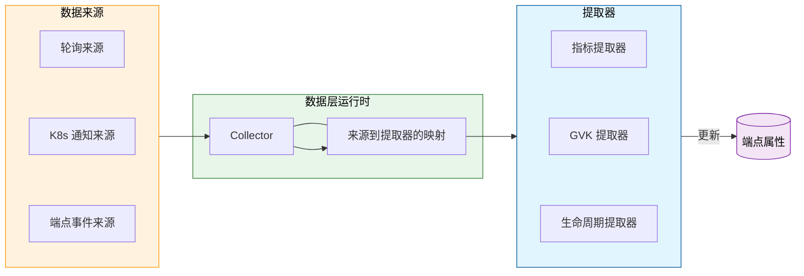

# 数据层

数据层是 EPP 内一个可插拔、可扩展的组件，负责采集、处理和存储模型服务器端点的实时状态。它提供基础数据——例如队列深度、KV 缓存利用率和 LoRA 适配器状态——供[请求调度](scheduling.md)和[流量控制](flow-control.md)插件做出有依据的决策。

## 架构概览 {#architecture-overview}

数据层是一个结合了响应式和轮询式的系统，为 `Endpoint` 对象补充元数据和动态属性。它遵循 **来源（Source）-> 提取（Extract）-> 属性（Attribute）** 的生命周期。

### 核心概念 {#core-concepts}

* **端点属性（Endpoint Attributes）**：存储在每个 `Endpoint` 上的线程安全、类型安全的映射。属性是数据层与 EPP 其他组件之间共享信息的主要方式。
* **数据来源（Data Source）**：从外部系统（例如 Prometheus 指标、Kubernetes API 或本地事件）获取原始数据的插件。
* **提取器（Extractor）**：把来源提供的原始数据转换为结构化属性并存储到端点上的插件。
* **运行时（Runtime）**：管理来源和提取器生命周期、编排轮询间隔并处理 Kubernetes 事件绑定的逻辑。

---

## 扩展点 {#extension-points}

数据层围绕三种主要的来源类型构建，每种都配有对应的提取器接口：

### 1. 轮询数据来源 {#1-polling-data-sources}

用于定期从模型服务器获取数据，主要是指标。

* **来源接口**：`PollingDataSource`（例如 `metrics-data-source`）
* **提取器接口**：`Extractor`（例如 `core-metrics-extractor`）
* **工作流程**：运行时为每个新端点启动一个 `Collector`。Collector 按配置的间隔轮询来源，并把结果传给关联的提取器。拉取指标是设计这类数据来源的主要动机。

### 2. 通知来源 {#2-notification-sources}

用于响应 Kubernetes 资源的变化。

* **来源接口**：`NotificationSource`（例如 `k8s-notification-source`）
* **提取器接口**：`NotificationExtractor`
* **工作流程**：运行时把这些来源绑定到 Kubernetes controller-runtime manager。当某个资源（例如 Pod 或 Service）发生变化时，来源会把事件分发给它的提取器。

### 3. 端点事件来源 {#3-endpoint-event-sources}

用于响应 EPP 内部的端点生命周期事件（新增、更新、删除）。

* **来源接口**：`EndpointSource`（例如 `endpoint-notification-source`）
* **提取器接口**：`EndpointExtractor`
* **工作流程**：当 EPP 的端点池发生变化时，这些来源通知提取器执行初始化或清理（例如初始化缓存或清除过期指标）。

---

## 具体插件 {#concrete-plugins}

### 来源 {#sources}

* **[`metrics-data-source`](https://github.com/llm-d/llm-d-router/tree/v0.11.0/pkg/epp/framework/plugins/datalayer/source/metrics)**——轮询模型服务器的 Prometheus 兼容指标端点，并把响应解析为便于提取的结构化格式。
* **[`k8s-notification-source`](https://github.com/llm-d/llm-d-router/tree/v0.11.0/pkg/epp/framework/plugins/datalayer/source/notifications)**——可配置为监视单个 Kubernetes GVK（CRD 或 k8s 核心 API），并在对象被创建、更新或删除时，向已注册的 `NotificationExtractor` 分发 `NotificationEvent`。单个来源可以把 GVK 变化通知给多个提取器。目前上游还没有需要此来源的提取器。
* **[`endpoint-notification-source`](https://github.com/llm-d/llm-d-router/tree/v0.11.0/pkg/epp/framework/plugins/datalayer/source/notifications)**——每当端点（即模型服务器引擎）被加入数据存储或从中移除时，把端点生命周期事件（新增、更新、删除）投递给已注册的 `EndpointExtractor`。

### 提取器 {#extractors}

* **[`core-metrics-extractor`](https://github.com/llm-d/llm-d-router/tree/v0.11.0/pkg/epp/framework/plugins/datalayer/extractor/metrics)**——负责从 `metrics-data-source` 提供的数据中提取一组模型服务器指标，并将其存储为端点属性（例如 `KVCacheUsagePercent` 和 `WaitingQueueSize`），供 `kv-cache-utilization-scorer` 等打分器使用。它支持多种推理引擎，并可配置为把引擎特定的指标名称映射到一组标准的内部键。
