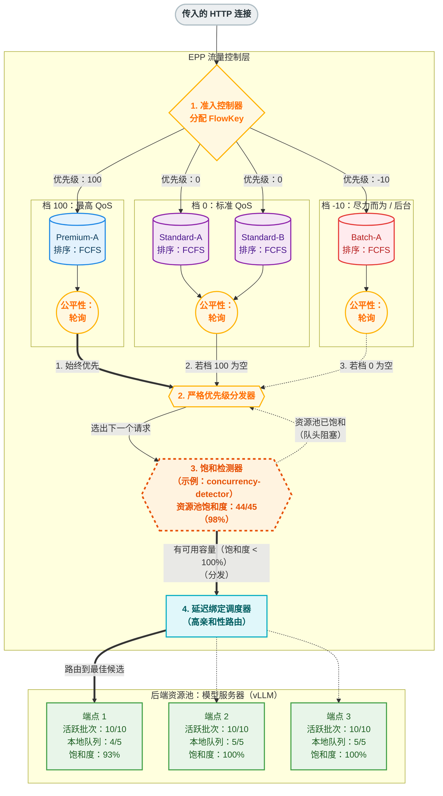
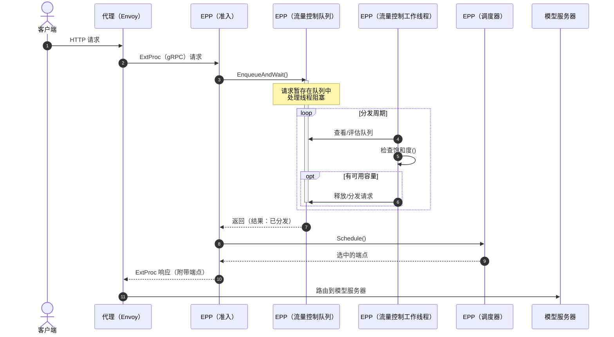
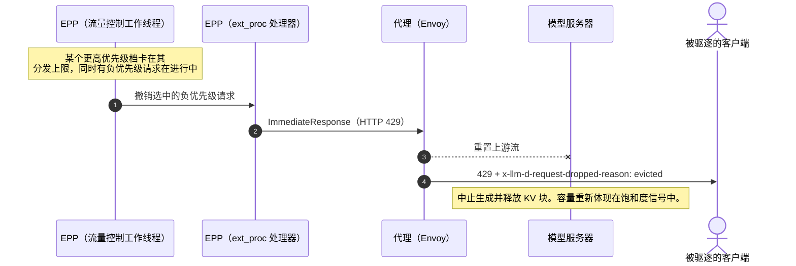
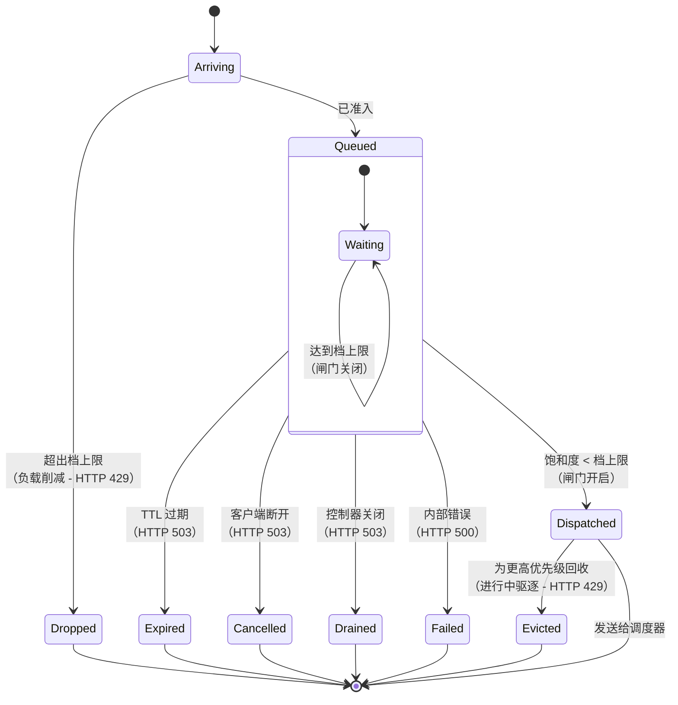
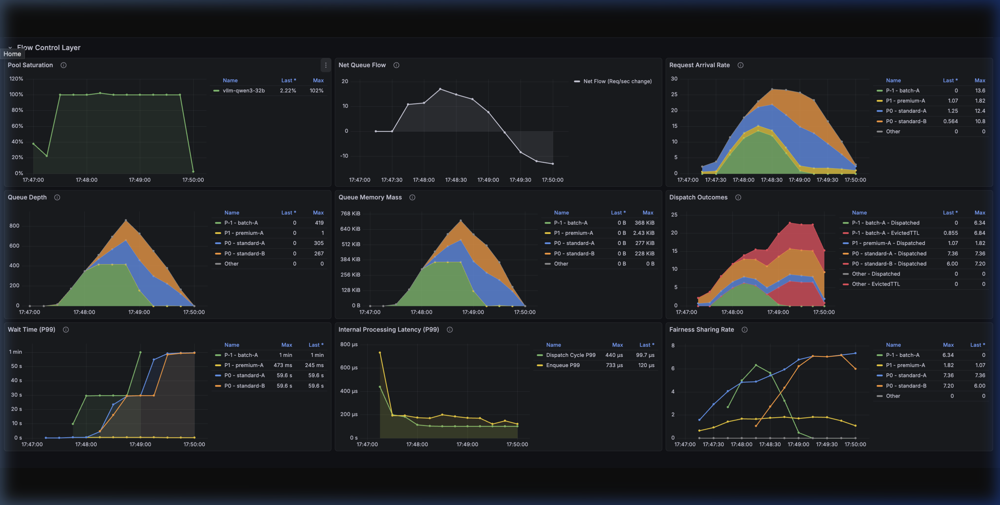

# 流量控制

EPP 中的流量控制层是资源池防护和多租户的关键机制。它把智能排队前移到网关，强制执行严格的优先级和租户感知的公平性，从而保护模型服务器资源池免于过载。

:::info
EPP 流量控制目前受 `flowControl` 特性开关控制。要使用这些能力，必须在 [EndpointPickerConfig](configuration.md) 中显式启用。
:::


### LLM 排队问题 {#the-llm-queuing-problem}

传统 API 网关按每秒请求数（RPS）限流，假设每个请求消耗的资源大致相同。在 LLM 服务中，这种方式并不适用。资源消耗由长输入上下文和不可预测的**自回归 decode 循环**（输出 token）决定。单个请求消耗的算力和内存可能比另一个请求高出几个数量级，使每个请求所需的服务容量差异极大。静态 RPS 限制要么过于保守而让资源池闲置，要么过于激进而导致过载。

没有流量控制时，会出现以下问题：

* **吵闹邻居**：单个租户发送超大提示词，可能独占某个端点的 KV 缓存和队列，让其他租户“饿死”。
* **调度后悔**：一旦请求被分发到模型服务器的本地队列，EPP 就无法再移动它。过早路由会把请求锁定在次优候选上，使其无法利用可能很快空闲出来的更好端点。
* **优先级反转**：模型服务器按到达顺序或序列长度组批，而不是按业务优先级。关键的实时请求可能卡在大型离线批次之后。
* **资源不对称**：一个带有超长上下文的请求，消耗的资源可能比数百个短请求还多。

把排队前移到 EPP 后，我们可以管控物理容量（KV 缓存、队列饱和度），而不仅仅是原始请求速率或连接数。

### 架构概览 {#architecture-overview}

流量控制层在 EPP 处拦截请求，并在后端资源池饱和时把它们暂存在集中式、具备策略感知的队列中。这样可以避免请求堆积在彼此隔离的端点队列里，在那里它们无法被动态重新路由或调整优先级。

#### 排队拓扑与三层分发 {#queuing-topology--the-3-tier-dispatch}

要理解策略插件如何工作，可以把排队拓扑想象成由两个维度构成的网格：**优先级（Priority）**和**流（Flow，即 Fairness ID）**。

1. **流识别**：每个请求都会被分配一个 `FlowKey`——即 `(FairnessID, Priority)` 二元组。
    * `FairnessID` 从 `x-llm-d-inference-fairness-id` 请求头中提取（例如租户 ID）。
    * `Priority` 由 `InferenceObjective` 推导。
2. **独立队列**：每个唯一的 `FlowKey` 对应一个独立的内存队列。

**优先级档（Priority Band）**是共享同一外部优先级值的所有队列（流）的逻辑分组。系统严格按顺序服务各个档，但在一个档*内部*，会按照公平性策略在各队列之间轮转。

系统通过严格的三个层次遍历这些队列，选出下一个要分发的请求：

* **第 1 层：优先级（选择档）**：系统总是先服务最高优先级的档。这是硬编码的，不可插拔。它会给出属于该优先级的所有队列。
* **第 2 层：公平性（选择流）**：在该优先级档内，由**公平性策略（Fairness Policy）**插件决定下一轮轮到哪个具体的流（租户）。
* **第 3 层：排序（选择请求）**：最后，在选中流的队列内，由**排序策略（Ordering Policy）**插件决定服务哪个具体请求。

#### 客户端集成：为流量打标 {#client-integration-tagging-traffic}

为了把请求放入正确的队列，客户端必须在 HTTP 请求上附加特定的请求头。

下面的示例演示了如何指定某个 `InferenceObjective`，并确保租户之间公平地共享资源：

```bash
curl -X POST http://${IP}:${PORT}/v1/completions \
  -H 'Content-Type: application/json' \
  -H 'x-llm-d-inference-fairness-id: tenant-a' \
  -H 'x-llm-d-inference-objective: premium-traffic' \
  -d '{
    "model": "default-model",
    "prompt": "Say hello"
  }'
```

:::warning
**信任边界**：在生产系统中，允许终端用户自行声明其租户 ID 或流量优先级（`premium-traffic`）会成为滥用的入口。在生产环境中，应从外部请求中剥离这些请求头，并由上游受信任的 API 网关、身份提供方或 Envoy AuthZ 过滤器根据 API 密钥注入。
:::


:::tip
**回退规则**：

* 如果缺少 **Fairness ID** 请求头，请求会回退到该优先级的单一全局桶中。
* 如果缺少 **Inference Objective** 请求头，或其引用的目标未设置优先级，请求默认为**优先级 `0`**。
:::


#### 两级优先级 {#two-levels-of-priority}

系统区分两级优先级：

1. **外部优先级（流量类别）**：跨租户和工作负载的粗粒度优先级划分（例如高级与尽力而为）。它由 `InferenceObjective` 管控，作用于**第 1 层**。允许使用负值，表示请求“可丢弃”。与旧的准入模式（在饱和时立即丢弃负优先级请求）不同，流量控制会把它们接纳进队列，但受运维人员配置的档容量上限约束，从而通过严格限定低优先级队列的大小来实现可控的负载削减。
2. **内部优先级（请求排序）**：*单个流内部*请求的细粒度优先级划分（例如最早截止时间优先）。它由 `OrderingPolicy` 管控，作用于**第 3 层**。

为了直观展示这些优先级层次与流之间的关系，下图描绘了 EPP 中的集中式排队拓扑：

---



### 配置示例 {#example-configuration}

为了让上图更具体，下面给出能产生上述行为的示例清单。

#### 1. InferenceObjective（流量类别） {#1-inferenceobjectives-traffic-classes}

这些资源定义流量的优先级。注意，对尽力而为的工作负载使用了负优先级。

```yaml
apiVersion: llm-d.ai/v1alpha2
kind: InferenceObjective
metadata:
  name: premium-traffic
spec:
  priority: 100
  poolRef:
    name: default-pool
---
apiVersion: llm-d.ai/v1alpha2
kind: InferenceObjective
metadata:
  name: standard-traffic
spec:
  priority: 0
  poolRef:
    name: default-pool
---
apiVersion: llm-d.ai/v1alpha2
kind: InferenceObjective
metadata:
  name: best-effort-traffic
spec:
  priority: -10
  poolRef:
    name: default-pool
```

#### 2. EPP 配置 {#2-epp-configuration}

下面这段 `EndpointPickerConfig` 展示了如何配置流量控制层来处理这些优先级档。

```yaml
apiVersion: llm-d.ai/v1alpha1
kind: EndpointPickerConfig
metadata:
  name: default-config
featureGates:
- flowControl
plugins:
- type: round-robin-fairness-policy
- type: fcfs-ordering-policy
- type: concurrency-detector
  parameters:
    maxConcurrency: 15
    concurrencyMode: requests
    headroom: 0.0
# ... 其他插件 ...

flowControl:
  saturationDetector:
    pluginRef: concurrency-detector

  maxBytes: "10Gi"
  maxRequests: "1k"
  defaultRequestTTL: "60s"
  priorityBands:
  - priority: 100
    maxRequests: "500"
    fairnessPolicyRef: round-robin-fairness-policy
    orderingPolicyRef: fcfs-ordering-policy
  - priority: 0
    maxRequests: "200"
    fairnessPolicyRef: round-robin-fairness-policy
    orderingPolicyRef: fcfs-ordering-policy
  - priority: -10
    maxRequests: "50"
    fairnessPolicyRef: round-robin-fairness-policy
    orderingPolicyRef: fcfs-ordering-policy

# ... 其他部分（schedulingProfiles、dataLayer 等）...
```

要理解这份配置如何执行，需要了解实现这些逻辑并施加资源护栏的核心组件。

### 核心组件 {#core-components}

* **流量控制器（Flow Controller）**：管理分发循环和队列评估的主编排器。
* **饱和检测器（Saturation Detector）**：查询资源池的整体健康状况（例如 KV 缓存利用率、队列深度），以决定闸门应开启还是关闭。
* **队列（Queues）**：按 `FlowKey` 组织的内存存储结构（根据排序策略实现为列表或堆）。

### 资源护栏与内存隔离 {#resource-guardrails--memory-isolation}

为防止队列增长时 EPP 自身耗尽资源，流量控制会施加可配置的容量上限。关于如何设置 `maxBytes` 和 `maxRequests`，请参阅[配置指南中的全局字段一节](configuration.md#global-fields)：

* **全局上限**：通过 `maxBytes`（载荷大小）和 `maxRequests`（数量）在所有优先级档上配置。这些上限同时支持普通整数和 Kubernetes Quantity 格式（例如 `10Gi`、`1k`）。如果新请求会超出这些上限，它会立即以 HTTP 429（Too Many Requests）被拒绝。
* **每档上限**：每个优先级档可以有自己的 `maxBytes` 和 `maxRequests` 上限。这在各档之间提供了**内存隔离**；低优先级档的大流量无法占满为高优先级档预留的队列空间。

:::note
**代理防护与 GPU 防护**：务必区分这些流量控制上限与饱和检测器。`maxBytes` 和 `maxRequests` 上限保护的是**网关**的内存占用，防止代理层资源耗尽。饱和检测器（见下文）保护的是 **GPU** 的物理算力和 KV 缓存容量。
:::


### 分发生命周期 {#the-dispatch-lifecycle}

请求调度器以每请求同步的生命周期运行，而流量控制层维护的是一个异步、持续运行的 **入口与缓冲 → 策略评估 → 门控分发** 循环：



1. **入口与缓冲**：传入请求按 `FlowKey`（优先级 + Fairness ID）分类，并放入相应的队列。请求受可配置的 TTL（存活时间）约束；如果请求在队列中停留超过其 TTL，就会过期并被拒绝，避免系统处理过时的工作。
2. **策略评估**：流量控制工作线程持续评估各队列。它们选出有待处理工作的最高优先级档，应用**公平性策略**选出一个流，再使用**排序策略**选出候选请求。
3. **门控分发**：在释放请求之前，会查询**饱和检测器**。如果资源池有容量，请求就被分发给路由器。如果已饱和，分发周期就会暂停（队头阻塞），把请求安全地保留到有容量释放为止。

### 进行中请求驱逐 {#in-flight-eviction}

进行中请求驱逐会终止一个已分发的负优先级（`priority < 0`）请求，为卡在分发上限的更高优先级请求回收容量。门控分发只决定是否放行新工作，因此无法回收低优先级请求已经占用的容量。

当设置 `enableEviction: true`（参见[流量控制配置](configuration.md#flow-control)）时，流量控制可以结束一个已分发的**负优先级**（`priority < 0`）请求，为受阻的更高优先级需求腾出空间。只有当某个更高优先级档卡在其分发上限、且后面有请求在排队时才会发生驱逐，并且只针对负优先级档中的进行中请求。在默认的用量上限策略（Usage Limit Policy）下，该上限是资源池完全饱和；在 `priority-holdback-policy` 下，每个档会在更低的上限处保留余量，因此驱逐可能在资源池满之前就开始。默认的驱逐对象策略首先选择优先级最低的，其次选择最近分发的，因此已经完成最多工作的请求最后才会被驱逐。



驱逐会结束被驱逐的请求；只有当模型服务器在上游重置后中止生成并释放其 KV 块时，容量才会真正回收。流量控制假定引擎的回收时间是有界的，但不会直接观测它，因此在生产环境启用驱逐之前，请在你的引擎上验证被中止的请求能及时释放容量。被驱逐的调用方（客户端或上游网关）负责重试，其重试路径需要具备幂等性或请求级去重，以免重试的请求产生两个最终结果。请把驱逐留给其所有者可以安全重试的低优先级工作（例如负优先级档上的批处理作业）。

可以通过 `revocations_issued_total` 和 `revocations_total` 指标（参见[指标与可观测性](#metrics--observability)）以及 `x-llm-d-request-dropped-reason: evicted` 响应头来观测驱逐。

### 系统能力与局限 {#system-capabilities--limits}

了解流量控制层能保证的能力及其固有边界，对于做好容量规划至关重要。

#### 能解决什么（能力与保证） {#what-it-solves-capabilities--guarantees}

* **多租户公平性**：提供一个集中执行业务策略（优先级、公平性和防饿死）的位置。
* **动态延迟绑定**：把路由决策推迟到尽可能晚的时刻，从而把请求匹配到最优候选（例如前缀缓存亲和性高的端点）。
* **工作保持特性**：它是一个**工作保持（work-conserving）**系统（即只要 GPU 有空闲容量，就绝不会人为限流）；只要后端有容量，就会分发。
* **TPOT 保护**：通过防止 GPU 上的上下文颠簸（管理**计算强度**），确保请求分发后生成时间（**每输出 token 时间，Time-Per-Output-Token**）可预测。（注意：虽然也可以在模型服务器层面通过 vLLM 的 `max_num_seq` 等设置来管理，但那样缺乏全局视角。这种保护主要有益于**聊天流式输出**场景，在这类场景中维持与人类阅读速度相当的输出节奏至关重要。）

#### 不能解决什么（局限与取舍） {#what-it-does-not-solve-limits--trade-offs}

* **绝对容量不足**：流量控制只决定请求*何时*以及*以什么顺序*被分发。它无法让资源池变快，也无法凭空创造容量。
* **TTFT 只会转移（而不会消除）**：当系统超出容量时，流量控制无法消除等待时间。启用它意味着你**明确选择以排队时间为代价来保护 TPOT**。它的核心作用只是控制 TTFT（首 token 时间）在**哪里**、为**谁**累积（安全地在 EPP 中累积，而不是让它在 GPU 上造成上下文颠簸）。
* **不持久化**：队列纯粹存储在内存中。如果 EPP 进程重启或故障，排队中的请求会丢失。在优雅关闭期间，EPP 会以可重试的 HTTP 503（Service Unavailable）驱逐排队中的请求——表明这是暂时不可用，从而让客户端和上游网关重试，而不是把排空当成严重的服务器故障；而突然崩溃则会导致客户端连接被硬性断开。

### 故障模式与错误映射 {#failure-modes--error-mapping}

运维人员还应熟悉系统的故障模式，以及内部状态如何映射到面向客户端的错误。下表把内部 `QueueOutcome` 映射到返回给 Envoy 和客户端的公开错误约定。



`丢弃原因` 列给出 `x-llm-d-request-dropped-reason` 响应头中输出的值，运维人员可据此在链路上区分丢弃的确切原因（例如用于告警或客户端重试逻辑）。

| 队列结果 | 内部错误码 | HTTP 状态码 | 丢弃原因（`x-llm-d-request-dropped-reason`） | 说明 |
|---|---|---|---|---|
| `QueueOutcomeRejectedCapacity` | `ResourceExhausted` | 429（Too Many Requests） | `rejected-saturated` | 因达到队列容量上限（全局或每档）而被拒绝。 |
| 进行中驱逐（`enableEviction: true`） | *（ImmediateResponse，无内部错误码）* | 429（Too Many Requests） | `evicted` | 分发后回收，不属于 `QueueOutcome`：结束一个已分发的负优先级请求，为受阻的更高优先级需求回收容量。以 Envoy `ImmediateResponse` 返回，因此没有内部错误码。由被驱逐的调用方负责重试。参见[进行中请求驱逐](#in-flight-eviction)。 |
| `QueueOutcomeEvictedTTL` | `ServiceUnavailable` | 503（Service Unavailable） | `rejected-ttl-expired` | 因请求 TTL 过期而被移出队列。 |
| `QueueOutcomeEvictedContextCancelled` | `ServiceUnavailable` | 503（Service Unavailable） | `rejected-context-cancelled` | 因客户端断开而被移出队列。 |
| `QueueOutcomeRejectedOther` / `EvictedOther`（优雅排空） | `ServiceUnavailable` | 503（Service Unavailable） | `rejected-shutting-down` | 流量控制器在优雅关闭期间（例如滚动更新）排空排队中的请求，此时 EPP 仍然存活，其 ext_proc 流也仍然打开。这是暂时性的、可重试的，**不是**内部故障。 |
| `QueueOutcomeRejectedOther` / `EvictedOther`（其他） | `Internal` | 500（Internal Server Error） | *（无）* | 真正的流量控制内部错误。由于这是意外故障而非特定的移除策略，因此不设置丢弃原因请求头。 |

:::info
**这些映射仅在 EPP 可达时适用。**上表描述的是 EPP 通过存活的 ext_proc 流返回的结果——包括 503 优雅排空的情况，此时 EPP 仍在运行，足以完成对排队请求的收尾。一旦 EPP 进程真正消失（突然崩溃，或在 ext_proc 连接关闭后的关闭尾声），这些状态码都不再适用，因为 Envoy 根本收不到来自扩展的响应。此时会发生什么，由 `InferencePool` 的 [`failureMode`](../../inferencepool.md) 决定：

* **`FailOpen`**（由 [llm-d 路由器方案](https://github.com/llm-d/llm-d/blob/v0.10.0/guides/recipes/router/base.values.yaml)设置）：Envoy **绕过扩展，直接把请求路由到某个模型服务器端点**。请求*不会*被拒绝——但也**不会受到任何流量控制**：没有排队、公平性或饱和门控。这是用资源池防护保证换取可用性，因此在 EPP 宕机期间，请求可能落到已经饱和的后端上。
* **`FailClose`**（API 默认值）：Envoy 直接让请求失败，而不是绕过已失效的 EPP 进行路由。

换言之，EPP 的错误约定是尽力而为的，并且以 EPP 可达为前提；在 llm-d 默认（`FailOpen`）配置下，EPP 故障会退化为无保护的透传，而不会返回此表中的任何状态码。
:::


### 扩展点 {#extension-points}

流量控制层的行为可以通过多个以插件形式实现的扩展点进行定制。关于如何在配置中注册和引用这些插件，请参阅[配置指南中的流量控制一节](configuration.md#flow-control)：

1. **公平性策略（Fairness Policy）**：决定在完全相同的优先级内，如何在不同的流之间分配分发机会。
2. **排序策略（Ordering Policy）**：决定特定流内请求的服务顺序。
3. **饱和检测器（Saturation Detector）**：评估资源池是否还有容量进行更多分发。

### 具体插件 {#concrete-plugins}

#### 公平性策略 {#fairness-policies}

* **[`global-strict-fairness-policy`](https://github.com/llm-d/llm-d-router/tree/v0.11.0/pkg/epp/framework/plugins/flowcontrol/fairness/globalstrict/README.md)**：忽略流隔离，按照排序策略以单一的全局顺序服务所有请求。适用于必须在档内对所有请求执行严格全局排序、且不关心公平性的场景。
* **[`round-robin-fairness-policy`](https://github.com/llm-d/llm-d-router/tree/v0.11.0/pkg/epp/framework/plugins/flowcontrol/fairness/roundrobin/README.md)**：逐个轮转活跃的流，保证公平共享。防止单个大流量的流让其他流“饿死”（解决“吵闹邻居”问题）。

#### 排序策略 {#ordering-policies}

* **[`fcfs-ordering-policy`](https://github.com/llm-d/llm-d-router/tree/v0.11.0/pkg/epp/framework/plugins/flowcontrol/ordering/fcfs/README.md)**：按到达时间先到先服务。（默认）
* **[`edf-ordering-policy`](https://github.com/llm-d/llm-d-router/tree/v0.11.0/pkg/epp/framework/plugins/flowcontrol/ordering/edf/README.md)**：最早截止时间优先，优先处理过期时间最近的请求。
* **[`slo-deadline-ordering-policy`](https://github.com/llm-d/llm-d-router/tree/v0.11.0/pkg/epp/framework/plugins/flowcontrol/ordering/slodeadline/README.md)**：按根据到达时间计算出的基于 SLO 的截止时间对请求排序。使用 `x-llm-d-slo-ttft-ms` 请求头。没有该请求头的请求会排在所有带 SLO 的请求之后，有被饿死的风险。

#### 饱和检测器 {#saturation-detectors}

饱和检测器的行为取决于是否启用了流量控制：

* **启用流量控制**：当资源池饱和时，请求分发暂停，传入请求被缓冲在流量控制的内存队列中（遵循优先级和公平性策略），直到后端有容量释放。饱和检测器充当这些集中式队列的守门人；详情请参阅[分发生命周期一节](#the-dispatch-lifecycle)。
* **未启用流量控制**（默认）：当资源池饱和时，“可丢弃”的请求（负优先级的请求）会立即以 HTTP 429（Too Many Requests）被拒绝。其他所有请求直接透传给模型服务器。

可用插件：

* **[`utilization-detector`](https://github.com/llm-d/llm-d-router/tree/v0.11.0/pkg/epp/framework/plugins/flowcontrol/saturationdetector/utilization/README.md)**：闭环检测器，对实时遥测数据（队列深度、KV 缓存）做出反应。非常准确，但受遥测延迟影响（“惊群”效应）。在异构资源池中，它平等对待所有端点（不加权平均），这意味着一个饱和的小端点就可能触发全局背压。（默认）
* **[`concurrency-detector`](https://github.com/llm-d/llm-d-router/tree/v0.11.0/pkg/epp/framework/plugins/flowcontrol/saturationdetector/concurrency/README.md)**：开环检测器，基于活跃进行中请求的计数。反应即时，但对实际的硬件内存压力（KV 缓存填满）视而不见。在异构资源池中，它偏向较大端点的状态（总容量模型）。

:::note
#### “健康缓冲”原则 {#the-healthy-buffer-principle}

无论使用哪种检测器，调优饱和检测的核心目标都是在模型服务器本地保持一个小的**“健康缓冲”**——即少量在本地排队的请求。

这个缓冲应当刚好足够大，以确保连续批处理引擎永远不会缺活；同时又足够小，使绝大部分排队发生在 EPP 中心，在那里可以执行优先级和公平性策略。

**调优缓冲：**

调优这个缓冲需要调整所配置的饱和检测器的具体参数。例如：

* 在 `utilization-detector` 中，通常通过 `queueDepthThreshold` 参数控制。
* 在 `concurrency-detector` 中，通过把 `maxConcurrency` 设置为略高于模型服务器的有效批大小来控制。

各检测器可用调节项的完整细节，请参阅上面链接的各自 README。
:::


### 高级用例：自动扩缩容 {#advanced-use-cases-autoscaling}

#### 基于真实需求的自动扩缩容 {#true-demand-autoscaling}

GPU 利用率等传统指标无法量化未被满足的需求，因为 LLM 计算高度非线性。把队列前移到 EPP 后，就获得了一个确定的“真实需求”指标（队列深度）。KEDA 等外部扩缩器可以使用该指标，按照等待服务的流量的确切规模扩容副本。更多细节请参阅[自动扩缩容](../../../advanced/autoscaling/README.md)。

### 指标与可观测性 {#metrics--observability}

流量控制层暴露了详细的指标，用于跟踪排队动态和系统健康状况。

| 指标名称 | 指标类型 | 说明 | 标签 |
|:---|:---|:---|:---|
| `llm_d_epp_flow_control_request_queue_duration_seconds` | Histogram | 请求在流量控制层中从入队到最终结果所花的时间。 | `fairness_id`, `priority`, `outcome`, `inference_pool`, `model_name`, `target_model_name` |
| `llm_d_epp_flow_control_queue_size` | Gauge | 当前在流量控制队列中暂存的请求数。 | `fairness_id`, `priority`, `inference_pool`, `model_name`, `target_model_name` |
| `llm_d_epp_flow_control_queue_bytes` | Gauge | 当前在流量控制队列中暂存的请求总字节数。 | `fairness_id`, `priority`, `inference_pool`, `model_name`, `target_model_name` |
| `llm_d_epp_flow_control_dispatch_cycle_duration_seconds` | Histogram | 每个内部分发周期所花的时间。 | 无 |
| `llm_d_epp_flow_control_request_enqueue_duration_seconds` | Histogram | 请求进入流量控制层入队所花的时间。 | `fairness_id`, `priority`, `outcome` |
| `llm_d_epp_flow_control_pool_saturation` | Gauge | 门控分发的资源池饱和度信号（1.0 为门控设定点）。 | `inference_pool` |
| `llm_d_epp_flow_control_stale_endpoints` | Gauge | 指标缺失或超过陈旧阈值的候选端点数。 | `detector` |
| `llm_d_epp_flow_control_requests_total` | Counter | 流量控制层按结果统计的已处理请求总数。 | `outcome`, `priority`, `inference_pool` |
| `llm_d_epp_flow_control_revocations_issued_total` | Counter | 已发出的进行中驱逐撤销总数，按需求所在档的优先级打标。设置 `enableEviction` 时输出。 | `priority`, `inference_pool` |
| `llm_d_epp_flow_control_revocations_total` | Counter | 按最终结果（`confirmed`、`timed_out`）统计的进行中驱逐撤销总数。每次发出的撤销最终都会恰好递增一个结果。 | `outcome`, `inference_pool` |
| `llm_d_epp_flow_control_reclaim_target` | Gauge | 最近一次计算出的回收缺口，以饱和度 gauge 为单位。 | `inference_pool` |
| `llm_d_epp_flow_control_pending_reclaim` | Gauge | 未完成及冷却中的待回收借记之和，以饱和度 gauge 为单位。 | `inference_pool` |
| `llm_d_epp_flow_control_revocation_confirmation_seconds` | Histogram | 从发出撤销到确认流终止的时间。 | `inference_pool` |
| `llm_d_epp_program_aware_jains_fairness_index` | Gauge | 基于各活跃程序平均等待时间计算的 Jain 公平性指数。 | 无 |
| `llm_d_epp_program_aware_avg_wait_time_milliseconds` | Gauge | 每个程序在流量控制队列中等待时间的累计平均值（毫秒）。 | `program_id` |
| `llm_d_epp_program_aware_attained_service_tokens` | Gauge | 每个程序随时间衰减的已获得服务量（加权消耗的 token 数）。 | `program_id` |

上面五个与撤销和回收相关的指标仅在 `enableEviction: true` 时适用。在上线过程中请关注 `revocations_total{outcome="timed_out"}`：它统计的是流终止始终未被确认的撤销，控制器会把这些视为已确认，以免挂起的流一直把节奏闸门关着。如果该值持续非零，意味着回收量是按可能并未真正回来的容量来计算的。

#### Grafana 仪表盘 {#grafana-dashboard}

我们提供了预配置的 Grafana 仪表盘来可视化这些指标，便于监控队列深度、分发延迟和饱和状态的变化。

要加载该仪表盘，请按照[可观测性部署指南](../../../../operations/observability/setup.md)操作，它会安装 Prometheus 和 Grafana 并加载 llm-d 仪表盘。


