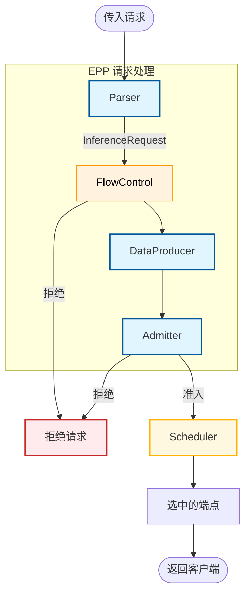

# 请求处理器

## 功能 {#functionality}

请求处理器管理推理请求在 EPP 中请求调度阶段之前和之后的生命周期。它负责解析请求载荷、为[请求调度器](scheduling.md)准备和管理状态、与[流量控制](flow-control.md)交互，以及处理来自模型服务器的响应。

## 设计 {#design}

### 架构概览 {#architecture-overview}

#### 核心组件 {#core-components}

* **Parser（解析器）**：负责把传入请求解析为请求调度器可使用的结构化内部表示，并在模型服务器上报用量时解析响应以提取用量数据。
* **DataProducer（数据生产者）**：可插拔的扩展，用于定制请求预处理并生成调度所需的每请求状态，例如分词、前缀缓存匹配、预测的处理延迟等。
* **Admitter（准入器）**：根据延迟 SLO 等条件决定是否准入请求。它在 DataProducer 之后、请求调度之前运行。未通过准入的请求会被拒绝，通过准入的请求进入请求调度阶段。

#### 高级钩子 {#advanced-hooks}

框架还在请求控制层支持高级的、自动解析的钩子。如果插件实现了这些接口，就会被自动接入执行流程：

* **`PreRequest`**：在请求被处理之前执行（例如递增进行中请求计数）。
* **`ResponseHeaderProcessor`**：在从后端收到响应头时执行。
* **`ResponseBodyProcessor`**：在响应流式传输期间执行（例如在完成时跟踪用量）。

:::note
实践中，这些接口通常由数据生产者实现，用于在请求生命周期中维护状态或跟踪指标。例如，`predicted-latency-producer` 实现了这些钩子来跟踪请求延迟。
:::

---

### 具体插件 {#concrete-plugins}

#### 解析器 {#parsers}

解析器插件理解请求和响应的载荷。这对于前缀缓存感知调度和响应用量跟踪等功能至关重要。

* **[`openai-parser`](https://github.com/llm-d/llm-d-router/tree/v0.11.0/pkg/epp/framework/plugins/requesthandling/parsers/openai)**：支持 OpenAI API 的默认解析器。支持的端点：`/conversations`、`/responses`、`/chat/completions`、`/completions`、`/embeddings`。
* **[`vllmgrpc-parser`](https://github.com/llm-d/llm-d-router/tree/v0.11.0/pkg/epp/framework/plugins/requesthandling/parsers/vllmgrpc)**：处理 vLLM gRPC API 的请求。支持的方法：`Generate`、`Embed`。
* **[`passthrough-parser`](https://github.com/llm-d/llm-d-router/tree/v0.11.0/pkg/epp/framework/plugins/requesthandling/parsers/passthrough)**：与模型无关的解析器，原样透传内容而不做解析。注意，使用该解析器时不支持与载荷相关的调度（例如 `prefix-cache-scorer`）。

#### 准入器插件 {#admitter-plugins}

* **[`latency-slo-admitter`](https://github.com/llm-d/llm-d-router/tree/v0.11.0/pkg/epp/framework/plugins/requestcontrol/admitter/latencyslo/README.md)**：当没有任何端点能满足延迟 SLO 约束时，拒绝可丢弃的请求（priority < 0）。

#### 数据生产者 {#data-producers}

* **[`predicted-latency-producer`](https://github.com/llm-d/llm-d-router/tree/v0.11.0/pkg/epp/framework/plugins/requestcontrol/dataproducer/predictedlatency/README.md)**：通过 Sidecar 训练 XGBoost 模型，并为每个端点生成 TTFT/TPOT 预测。它计算 SLO 余量、收集训练数据，并跟踪每个端点的运行中请求队列。
* **[`inflight-load-producer`](https://github.com/llm-d/llm-d-router/tree/v0.11.0/pkg/epp/framework/plugins/requestcontrol/dataproducer/inflightload)**：跟踪每个端点的进行中请求数和预估 token 数。它在 `PreRequest` 中递增计数，在 `ResponseBodyProcessor` 中于流结束时递减。
* **[`approx-prefix-cache-producer`](https://github.com/llm-d/llm-d-router/tree/v0.11.0/pkg/epp/framework/plugins/requestcontrol/dataproducer/approximateprefix)**：为近似前缀缓存感知调度准备数据：把提示词按块哈希，并与记录服务器上已缓存前缀的索引器进行匹配。

---

## 指标与可观测性 {#metrics--observability}

请求处理子系统暴露了用于跟踪请求量、成功率、延迟和 token 用量的指标。除非另有说明，请求和延迟指标都带有标签集 `{model_name, target_model_name, fairness_id, priority}`。

#### 请求量与成功率 {#request-volume--success}

| 指标 | 类型 | 说明 | 标签 |
|--------|------|-------------|--------|
| `llm_d_epp_request_total` | Counter | 请求总数 | `model_name`, `target_model_name`, `fairness_id`, `priority` |
| `llm_d_epp_request_error_total` | Counter | 错误总数 | `model_name`, `target_model_name`, `fairness_id`, `priority`, `error_code` |
| `llm_d_epp_request_running` | Gauge | 当前活跃的运行中请求数 | `model_name`, `target_model_name`, `fairness_id`, `priority` |

#### 延迟与 SLO {#latency--slos}

| 指标 | 类型 | 说明 | 标签 |
|--------|------|-------------|--------|
| `llm_d_epp_request_duration_seconds` | Histogram | 端到端响应延迟 | `model_name`, `target_model_name`, `fairness_id`, `priority` |
| `llm_d_epp_request_ntpot_seconds` | Histogram | 归一化的每输出 token 时间（NTPOT） | `model_name`, `target_model_name`, `fairness_id`, `priority` |
| `llm_d_epp_request_ttft_seconds` | Histogram | 首 token 时间（TTFT） | `model_name`, `target_model_name`, `fairness_id`, `priority`, `streaming` |
| `llm_d_epp_request_streaming_tpot_seconds` | Histogram | 平均每输出 token 时间（流式） | `model_name`, `target_model_name`, `fairness_id`, `priority` |
| `llm_d_epp_request_streaming_itl_seconds` | Histogram | token 间延迟（流式） | `model_name`, `target_model_name`, `fairness_id`, `priority` |
| `llm_d_epp_request_predicted_ttft_seconds` | Histogram | 预测的 TTFT | `plugin_name`, `plugin_type`, `model_name`, `target_model_name` |
| `llm_d_epp_request_ttft_prediction_duration_seconds` | Histogram | 预测 TTFT 所花的时间 | `plugin_name`, `plugin_type`, `model_name`, `target_model_name` |
| `llm_d_epp_request_predicted_tpot_seconds` | Histogram | 预测的 TPOT | `plugin_name`, `plugin_type`, `model_name`, `target_model_name` |
| `llm_d_epp_request_tpot_prediction_duration_seconds` | Histogram | 预测 TPOT 所花的时间 | `plugin_name`, `plugin_type`, `model_name`, `target_model_name` |
| `llm_d_epp_request_slo_violation_total` | Counter | 违反 SLO 的请求总数 | `plugin_name`, `plugin_type`, `model_name`, `target_model_name`, `type` |

#### 载荷与 token 用量 {#payload--token-usage}

| 指标 | 类型 | 说明 | 标签 |
|--------|------|-------------|--------|
| `llm_d_epp_request_size_bytes` | Histogram | 传入请求体大小（字节） | `model_name`, `target_model_name`, `fairness_id`, `priority` |
| `llm_d_epp_response_size_bytes` | Histogram | 传出响应体大小（字节） | `model_name`, `target_model_name`, `fairness_id`, `priority` |
| `llm_d_epp_request_input_tokens` | Histogram | 每个请求的输入 token 数 | `model_name`, `target_model_name`, `fairness_id`, `priority` |
| `llm_d_epp_request_output_tokens` | Histogram | 每个请求的输出 token 数 | `model_name`, `target_model_name`, `fairness_id`, `priority` |
| `llm_d_epp_request_cached_tokens` | Histogram | 从缓存读取的提示词 token 数分布 | `model_name`, `target_model_name`, `fairness_id`, `priority` |

> **注意：**响应级指标（响应大小、输出 token 数、NTPOT）要求 Envoy 的 body 模式设置为 `Buffered` 或 `Streamed`。对于带用量数据的 vLLM 流式响应，请在请求中加入 `stream_options: {"include_usage": true}`。

#### 处理开销、模型重写与请求 Gauge {#processing-overhead-model-rewrite--request-gauges}

| 指标 | 类型 | 说明 | 标签 |
|--------|------|-------------|--------|
| `llm_d_epp_request_processing_duration_seconds` | Histogram | 从收到请求到请求体处理完成的时间 | *无* |
| `llm_d_epp_response_processing_duration_seconds` | Histogram | EPP 响应处理延迟 | *无* |
| `llm_d_epp_inference_request_metric` | Gauge | 请求指标的汇总 Gauge | `plugin_name`, `plugin_type`, `model_name`, `target_model_name`, `type` |
| `llm_d_epp_model_rewrite_decisions_total` | Counter | 模型重写决策总数 | `model_rewrite_name`, `model_name`, `target_model` |

#### 进行中负载 {#in-flight-load}

在配置了 `InFlightLoadProducer` 时输出：

| 指标 | 类型 | 说明 | 标签 |
|--------|------|-------------|--------|
| `llm_d_epp_inflight_requests` | Gauge | 每个端点上当前进行中的请求数 | `endpoint_name`, `namespace`, `producer_name`, `fairness_id`, `priority` |
| `llm_d_epp_inflight_tokens` | Gauge | 每个端点上当前进行中的 token 数（未命中缓存的提示词 token，可选择加上预估输出） | `endpoint_name`, `namespace`, `producer_name`, `fairness_id`, `priority` |

#### ext_proc 流 {#ext_proc-streams}

覆盖 ext_proc gRPC 流生命周期的可选指标（通过 `--enable-grpc-stream-metrics` 启用）：

| 指标 | 类型 | 说明 | 标签 |
|--------|------|-------------|--------|
| `llm_d_epp_extproc_streams_inflight` | Gauge | 当前打开的 ext_proc gRPC 流数量 | *无* |
| `llm_d_epp_extproc_stream_duration_seconds` | Histogram | ext_proc gRPC 流保持打开的时长（秒） | *无* |
| `llm_d_epp_extproc_streams_total` | Counter | 按 gRPC 状态码统计的已完成 ext_proc gRPC 流总数 | `code` |
