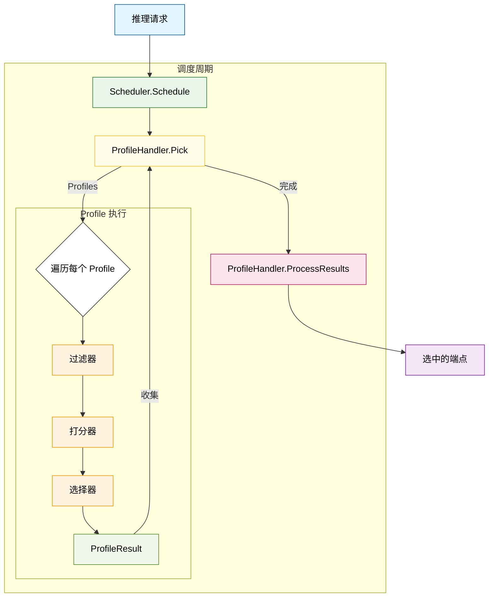
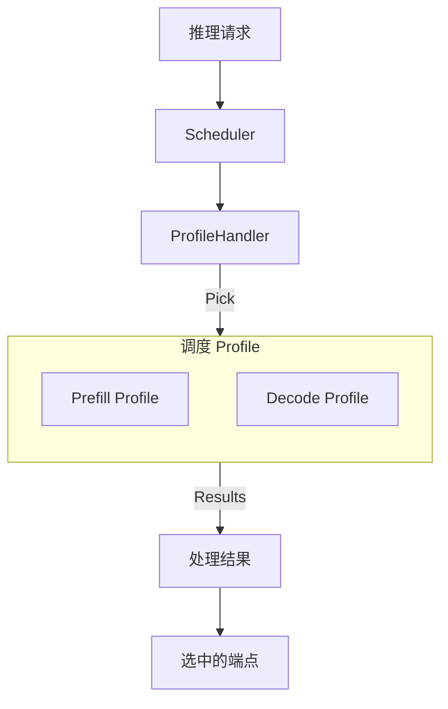

# 请求调度器

请求调度器是 EPP 中一个高度模块化、可扩展的组件，用于为推理请求选择最优的模型服务器（端点）。它采用基于插件的架构，可以基于实时指标、前缀缓存追踪以及 LoRA 适配器等模型特定需求，实现精细的端点选择策略。

## 架构概览 {#architecture-overview}

调度器的核心是为每个请求执行 **过滤（Filter）-> 打分（Score）-> 选择（Pick）** 的生命周期。它编排多个**调度配置（SchedulerProfile）**，每个配置定义一组用于过滤和打分候选端点的插件。

### 核心组件 {#core-components}

* **Scheduler（调度器）**：管理调度周期的主编排器。它调用配置的 `ProfileHandler` 来选择 Profile，然后运行选中的 Profile 以得到目标端点。
* **InferenceRequest（推理请求）**：由 [`Parser`](request-handling.md) 生成的传入请求的结构化内部表示，包括目标模型、解析后的请求体（Completions、ChatCompletions 等）、请求头和目标。
* **Endpoint（端点）**：表示一个候选服务引擎，包含其元数据（例如 Pod 名称、命名空间和端口）和状态（例如活跃模型、队列深度和 KV 缓存）。注意，一个 Pod 可能在不同端口上运行一个或多个端点，[数据并行部署模式](https://docs.vllm.ai/en/latest/serving/data_parallel_deployment/)就是这种情况。

### 扩展点 {#extension-points}

调度器的逻辑分布在多个扩展点上，通过插件接口实现：

1. **ProfilePicker**：（由 `ProfileHandler` 实现）根据请求和上一周期的结果，选择要运行哪些 `SchedulerProfile`。
2. **Filter（过滤器）**：缩小候选端点列表（例如基于健康状况、SLO 余量或缓存亲和性）。
3. **Scorer（打分器）**：为每个通过过滤的端点给出 `0.0` 到 `1.0` 之间的分数。多个打分器可以加权组合。
4. **Picker（选择器）**：从已打分的列表中选出最终端点（例如最高分、加权随机）。
5. **ProcessResults**：（由 `ProfileHandler` 实现）汇总所有已执行 Profile 的结果，生成最终的 `SchedulingResult`。

### 调度配置 {#scheduling-profile}

`SchedulingProfile` 是一条配置好的流水线，包括：

* **Filters**：依次运行的一组 `Filter` 插件。
* **Scorers**：一组 `WeightedScorer` 对象，每个对象包含一个 `Scorer` 插件及其相对权重。
* **Picker**：做出最终选择的单个 `Picker` 插件。

Profile 运行时，首先过滤候选端点。如果还有剩余端点，就为每个端点计算加权汇总分数，然后把已打分的列表交给选择器。端点的最终得分计算方式是：把每个打分器返回的分数（范围在 0.0 到 1.0 之间）乘以其配置的权重，再把这些加权分数相加。例如，如果打分器 A（权重 2.0）返回 0.8，打分器 B（权重 1.0）返回 0.5，则该端点的最终得分为 `(0.8 * 2.0) + (0.5 * 1.0) = 2.1`。

---

## 具体插件 {#concrete-plugins}

:::info
下面列出的插件并非都默认配置。[默认配置](#)中只启用了经过挑选的一部分。
:::

### 过滤器 {#filters}

* **[`prefix-cache-affinity-filter`](https://github.com/llm-d/llm-d-router/tree/v0.11.0/pkg/epp/framework/plugins/scheduling/filter/prefixcacheaffinity)**：一个概率性过滤器，把候选范围缩小到“粘性”端点（前缀缓存得分高的端点）。它包含一个“TTFT 负载闸门”，当粘性端点明显慢于非粘性端点时打破粘性。
* **[`slo-headroom-tier-filter`](https://github.com/llm-d/llm-d-router/tree/v0.11.0/pkg/epp/framework/plugins/scheduling/filter/sloheadroomtier)**：根据 SLO 余量档位过滤端点，以保障服务质量。
* **[`label-selector-filter`](https://github.com/llm-d/llm-d-router/tree/v0.11.0/pkg/epp/framework/plugins/scheduling/filter/bylabel)**：保留与配置的标签选择器匹配的端点。
* **[`prefill-filter`](https://github.com/llm-d/llm-d-router/tree/v0.11.0/pkg/epp/framework/plugins/scheduling/filter/bylabel)**：保留角色为 `prefill`、`encode-prefill`、`prefill-decode` 或 `encode-prefill-decode` 的端点。
* **[`decode-filter`](https://github.com/llm-d/llm-d-router/tree/v0.11.0/pkg/epp/framework/plugins/scheduling/filter/bylabel)**：保留角色为 `decode`、`prefill-decode` 或 `encode-prefill-decode` 的端点，并放行没有 `llm-d.ai/role` 标签的端点。原有的 `both` 角色已移除，请改用 `prefill-decode`。
* **[`encode-filter`](https://github.com/llm-d/llm-d-router/tree/v0.11.0/pkg/epp/framework/plugins/scheduling/filter/bylabel)**：保留角色为 `encode`、`encode-prefill` 或 `encode-prefill-decode` 的端点。

### 打分器 {#scorers}

*关于每个打分器具体如何计算分数（0.0 到 1.0），请参阅对应插件的文档。*

* **[`kv-cache-utilization-scorer`](https://github.com/llm-d/llm-d-router/tree/v0.11.0/pkg/epp/framework/plugins/scheduling/scorer/kvcacheutilization)**：优先选择 KV 缓存利用率较低的端点，以避免碎片化。
* **[`latency-scorer`](https://github.com/llm-d/llm-d-router/tree/v0.11.0/pkg/epp/framework/plugins/scheduling/scorer/latency)**：根据预测的延迟余量为端点打分，余量定义为预测请求延迟与用户 SLO（如已设置）之间的差距。
* **[`lora-affinity-scorer`](https://github.com/llm-d/llm-d-router/tree/v0.11.0/pkg/epp/framework/plugins/scheduling/scorer/loraaffinity)**：优先选择已激活所请求 LoRA 适配器、或有容量加载它的端点。
* **[`prefix-cache-scorer`](https://github.com/llm-d/llm-d-router/tree/v0.11.0/pkg/epp/framework/plugins/scheduling/scorer/prefix)**：根据前缀缓存匹配长度打分。
* **[`queue-depth-scorer`](https://github.com/llm-d/llm-d-router/tree/v0.11.0/pkg/epp/framework/plugins/scheduling/scorer/queuedepth)**：优先选择请求队列较短的端点。
* **[`running-requests-size-scorer`](https://github.com/llm-d/llm-d-router/tree/v0.11.0/pkg/epp/framework/plugins/scheduling/scorer/runningrequests)**：根据当前活跃请求数打分。
* **[`token-load-scorer`](https://github.com/llm-d/llm-d-router/tree/v0.11.0/pkg/epp/framework/plugins/scheduling/scorer/tokenload)**：根据端点处理的总 token 负载（输入 + 输出）打分。
* **[`precise-prefix-cache-producer`](https://github.com/llm-d/llm-d-router/tree/v0.11.0/pkg/epp/framework/plugins/requestcontrol/dataproducer/preciseprefixcache)**（DataProducer，与 `prefix-cache-scorer` 配合使用）：从其基于事件的 KV 缓存索引中发布 `PrefixCacheMatchInfo`。在打分器上设置 `prefixMatchInfoProducerName: precise-prefix-cache-producer` 即可使用这种精确缓存状态。

:::note
如果没有显式设置 `prefixMatchInfoProducerName`，`prefix-cache-scorer` 会回退到自动实例化的 `approx-prefix-cache-producer`。
:::

* **[`session-affinity-scorer`](https://github.com/llm-d/llm-d-router/tree/v0.11.0/pkg/epp/framework/plugins/scheduling/scorer/sessionaffinity)**：为处理过同一会话先前请求的特定端点给出最高分，其他所有端点得最低分。
* **[`no-hit-lru-scorer`](https://github.com/llm-d/llm-d-router/tree/v0.11.0/pkg/epp/framework/plugins/scheduling/scorer/nohitlru)**：对于冷请求（缓存命中为零），优先选择从未处理过冷请求的端点，其次是最近最少使用的端点。这确保了高强度的“prefill”工作负载在整个集群中均匀分布。如果请求已有缓存命中，该打分器会给所有端点相同的分数（即不产生影响）。

### 选择器 {#pickers}

* **[`max-score-picker`](https://github.com/llm-d/llm-d-router/tree/v0.11.0/pkg/epp/framework/plugins/scheduling/picker/maxscore)**：选择得分绝对最高的端点。这是**默认选择器**——任何未引用选择器的 Profile 都会自动注入它，默认 `maxNumOfEndpoints: 1`（返回唯一的最佳端点）。
* **[`random-picker`](https://github.com/llm-d/llm-d-router/tree/v0.11.0/pkg/epp/framework/plugins/scheduling/picker/random)**：从候选中随机选择一个端点。
* **[`weighted-random-picker`](https://github.com/llm-d/llm-d-router/tree/v0.11.0/pkg/epp/framework/plugins/scheduling/picker/weightedrandom)**：以分数作为相对概率随机选择端点（彩票调度）。

### Profile 处理器 {#profile-handlers}

* **[`single-profile-handler`](https://github.com/llm-d/llm-d-router/tree/v0.11.0/pkg/epp/framework/plugins/scheduling/profilehandler/single)**：运行单个配置的主 Profile。
* **[`disagg-profile-handler`](https://github.com/llm-d/llm-d-router/tree/v0.11.0/pkg/epp/framework/plugins/scheduling/profilehandler/disagg)**：运行两个调度 Profile，一个用于 prefill，一个用于 decode。**decode 端点**被设为代理转发原始请求的主要目标，而 **prefill 端点**则作为专用请求头注入到请求中。

:::note
旧的处理器 `data-parallel-profile-handler` 已**弃用**，仅为向后兼容而保留，请改用 `single-profile-handler`。
:::

---

## 高级用例：Prefill/Decode 分离 {#advanced-use-cases-prefilldecode-disaggregation}

调度器原生支持高级调度范式，例如 **Prefill/Decode 分离（P/D 分离）**。这是一种服务技术：初始的提示词处理（prefill）和随后的 token 生成（decode）由不同的专用模型服务器分别处理。

在 P/D 分离配置中，`ProfileHandler` 编排两个独立的 `SchedulerProfile`：

1. **Prefill Profile**：评估并打分专门用于计算密集型提示词处理的端点。它可能使用侧重前缀缓存亲和性、队列深度或 token 负载的过滤器和打分器。
2. **Decode Profile**：评估并打分专门用于内存带宽密集型 token 生成的端点。

`ProfileHandler` 使用 `Pick` 扩展点决定给定请求需要运行哪些 Profile（例如请求同时需要 prefill 和 decode，或者 KV 缓存已传输时只需要 decode）。如果两者都需要，则同时选出 prefill 和 decode 端点。然后，`ProfileHandler` 使用 `ProcessResults` 扩展点合并两个 Profile 的结果。合并确保 **decode 端点**作为代理转发原始请求的主要目标返回，同时 **prefill 端点**作为专用请求头注入到请求中。当请求到达 decode 工作节点时，与 decoder 一起运行的 **Sidecar** 会拦截请求，从请求头中提取 prefill 端点，并在开始 decode 之前，协调选中的 prefill 工作节点完成远程 prefill。

设计和请求流程的更多细节请参阅[分离式服务](../../../advanced/disaggregation/README.md)。

---

## 指标与可观测性 {#metrics--observability}

EPP 调度器暴露了详细的指标，用于跟踪资源池健康状况和调度决策。

### 资源池与调度指标 {#pool--scheduling-metrics}

以下指标提供 InferencePool 健康状况和调度决策的可见性。

#### 资源池健康指标 {#pool-health-metrics}

| 指标 | 类型 | 标签 | 说明 |
|--------|------|--------|-------------|
| `llm_d_epp_ready_endpoints` | Gauge | `name` | 资源池中就绪的端点数 |
| `llm_d_epp_average_kv_cache_utilization` | Gauge | `name` | 资源池的平均 KV 缓存利用率 |
| `llm_d_epp_average_queue_size` | Gauge | `name` | 资源池的平均待处理请求数 |
| `llm_d_epp_average_running_requests` | Gauge | `name` | 资源池的平均运行中请求数 |
| `llm_d_epp_std_dev_kv_cache_utilization` | Gauge | `name` | 资源池 KV 缓存利用率的标准差 |
| `llm_d_epp_std_dev_queue_size` | Gauge | `name` | 资源池待处理请求数的标准差 |
| `llm_d_epp_std_dev_running_requests` | Gauge | `name` | 资源池运行中请求数的标准差 |
| `llm_d_epp_per_endpoint_queue_size` | Gauge | `name`, `model_server_endpoint` | 每个端点的队列长度 |

#### 调度器性能指标 {#scheduler-performance-metrics}

| 指标 | 类型 | 标签 | 说明 |
|--------|------|--------|-------------|
| `llm_d_epp_scheduler_attempts_total` | Counter | `status`, `target_model_name`, `endpoint_name`, `namespace`, `port` | 调度尝试次数及其结果 |
| `llm_d_epp_scheduler_e2e_duration_seconds` | Histogram | *无* | 端到端调度延迟 |
| `llm_d_epp_plugin_duration_seconds` | Histogram | `extension_point`, `plugin_type`, `plugin_name` | 每个插件的处理延迟 |
| `llm_d_epp_plugin_data_scope_violations_total` | Counter | `extension_point`, `plugin_type`, `plugin_name`, `access` | 因未声明 DataKey 而被拒绝的端点属性访问（`read` 或 `write`） |

#### 进行中负载指标 {#in-flight-load-metrics}

| 指标 | 类型 | 标签 | 说明 |
|--------|------|--------|-------------|
| `llm_d_epp_inflight_requests` | Gauge | `endpoint_name`, `namespace`, `producer_name`, `fairness_id`, `priority` | 每个端点上当前进行中的请求数 |
| `llm_d_epp_inflight_tokens` | Gauge | `endpoint_name`, `namespace`, `producer_name`, `fairness_id`, `priority` | 每个端点上当前进行中的 token 数 |

#### 分离指标 {#disaggregation-metrics}

| 指标 | 类型 | 标签 | 说明 |
|--------|------|--------|-------------|
| `llm_d_epp_disagg_decision_total` | Counter | `plugin_name`, `plugin_type`, `model_name`, `decision_type` | 分离路由决策（`decode-only`、`prefill-decode`、`encode-decode`、`encode-prefill-decode`） |
| `llm_d_epp_pd_decision_total` | Counter | `plugin_name`, `plugin_type`, `model_name`, `decision_type` | Prefill/Decode 决策（已弃用的处理器） |
| `llm_d_epp_disaggregatedset_strict_header_no_match_total` | Counter | `plugin_type`, `plugin_name`, `selector` | 未匹配到任何端点的严格请求头选择次数 |
| `llm_d_epp_disaggregatedset_revision_gating_share` | Gauge | `plugin_type`, `plugin_name`, `mode`, `revision` | 当前的加权修订版本门控份额 |

#### 前缀缓存指标（近似） {#prefix-cache-metrics-approximate}

| 指标 | 类型 | 标签 | 说明 |
|--------|------|--------|-------------|
| `llm_d_epp_prefix_indexer_size` | Gauge | `plugin_name`, `plugin_type` | 近似前缀索引器的大小 |
| `llm_d_epp_prefix_indexer_hit_ratio` | Histogram | `plugin_name`, `plugin_type` | 前缀匹配的命中率 |
| `llm_d_epp_prefix_indexer_hit_bytes` | Histogram | `plugin_name`, `plugin_type` | 前缀缓存查找中匹配的字节数 |

#### 数据层错误 {#data-layer-errors}

| 指标 | 类型 | 标签 | 说明 |
|--------|------|--------|-------------|
| `llm_d_epp_datalayer_poll_errors_total` | Counter | `source_type` | 数据来源轮询失败次数 |
| `llm_d_epp_datalayer_extract_errors_total` | Counter | `source_type`, `extractor_type` | 提取器失败次数 |

#### 多模态编码器缓存 {#multimodal-encoder-cache}

| 指标 | 类型 | 标签 | 说明 |
|--------|------|--------|-------------|
| `llm_d_epp_encoder_cache_queries_total` | Counter | `plugin_type`, `plugin_name`, `modality` | 编码器缓存查找次数 |
| `llm_d_epp_encoder_cache_hits_total` | Counter | `plugin_type`, `plugin_name`, `pod`, `modality` | 编码器缓存命中次数 |
| `llm_d_epp_encoder_cache_hit_ratio` | Histogram | `plugin_type`, `plugin_name` | 编码器缓存查找的命中率 |

#### 系统信息 {#system-info}

| 指标 | 类型 | 标签 | 说明 |
|--------|------|--------|-------------|
| `llm_d_epp_info` | Gauge | `commit`, `build_ref` | EPP 构建信息 |
