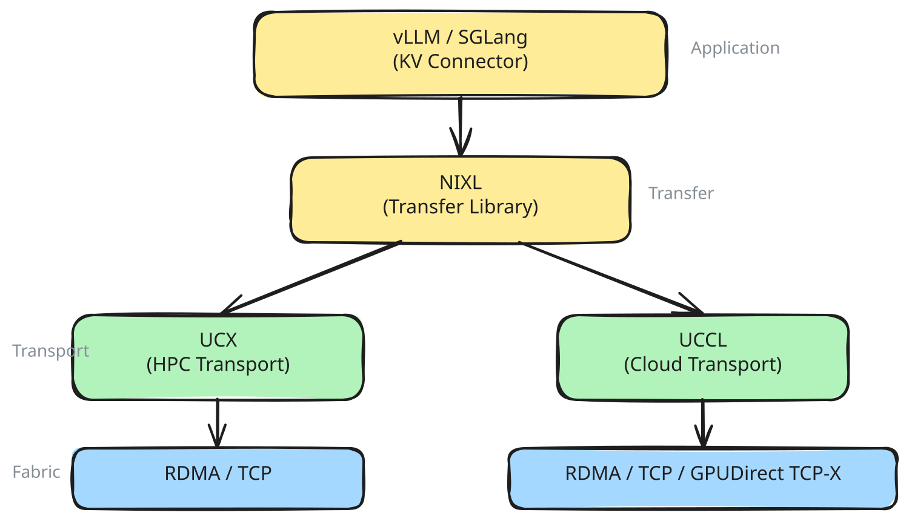

# 远程直接内存访问（RDMA）与网络配置

## 为什么网络很重要 {#why-networking-matters}

在 prefill/decode 分离中，必须先把键值（KV）缓存从 prefill 工作节点传输到 decode 工作节点，才能生成第一个 token。这段传输时间直接计入首 token 时间（TTFT）——并且其成本随上下文长度和模型规模增长。

对于宽专家并行，跨节点的 GPU all-to-all 通信位于每个生成 token 的关键路径上。

对于分布式推理延迟而言，网络是首要考量因素。

## 网络技术栈 {#the-networking-stack}

llm-d 使用分层的网络技术栈进行 KV 缓存传输和节点间通信：



### NIXL

[NIXL](https://github.com/ai-dynamo/nixl)（NVIDIA Inference Xfer Library）是 vLLM 用来在 GPU 之间搬运 KV 缓存的传输库。它把底层传输抽象在统一的 API 之后，因此 vLLM 无需了解网络结构即可发起传输。

NIXL 采用**拉取模型**：decode Pod 使用单边 RDMA 读（直接内存访问，不涉及远端 CPU）直接从 prefill Pod 的 GPU 显存中获取 KV 缓存块，不需要 prefill Pod 主动参与。这降低了同步开销。

主要能力：

- 适用于 InfiniBand、融合以太网上的 RDMA（RoCE）、Elastic Fabric Adapter（EFA）以及 TCP
- 支持 GPU 显存（VRAM）、CPU 动态内存（DRAM）以及存储后端
- 采用插件架构，便于添加新的传输后端
- 支持张量并行（TP）异构（prefill 和 decode 可以使用不同的张量并行规模）

### UCX

[UCX](https://openucx.org/)（Unified Communication X）是 NIXL 的默认传输后端。它是一个成熟的开源通信框架，在高性能计算（HPC）集群中被广泛采用。UCX 把 RDMA 传输（InfiniBand、RoCE）、共享内存和 TCP 抽象在同一个 API 之后。

UCX 是一个不错的默认选择：久经考验、支持广泛，并且适用于大多数硬件。不过，它是为 HPC 工作负载设计的，其复杂度会让它更难针对 AI 推理的流量模式进行调优。

### UCCL

[UCCL](https://github.com/uccl-project/uccl)（Unified Cloud Communication Library）是较新的传输后端，自 llm-d v0.5 起集成到 NIXL 中。它实现了由 CPU 管理的软件传输栈——在 CPU 上管理传输逻辑，而不是只依赖网卡（NIC）硬件卸载。这使得细粒度的流量拆分和自适应拥塞控制成为可能。

UCCL 目前支持：

- 原生 RDMA（InfiniBand/RoCE）
- GPUDirect TCP-X（Google Cloud）
- TCP
- EFA（AWS）

UCCL 默认使用 RDMA 传输。要切换到其他传输类型，请在运行时设置 `UCCL_P2P_TRANSPORT=ib|efa|nccl|tcp|tcpx`。
UCCL 会在内存注册期间根据 PCIe 亲近度自动发现网卡（NIC），因此在大多数情况下无需手动配置网卡与 GPU 的映射。UCCL 还支持使用 IPC 机制进行节点内传输。

### libfabric

在 AWS 上，NIXL 使用 [libfabric](https://ofiwg.github.io/libfabric/) 作为传输后端。EFA（Elastic Fabric Adapter）需要 OpenFabrics Interfaces（OFI）——UCX 不原生支持 EFA。libfabric 插件提供多通道 RDMA（同时使用多条网络路径以获得更高带宽），并通过 hwloc 实现拓扑感知的 GPU 到 EFA 映射。

### 选择传输后端 {#choosing-a-transport-backend}

| 环境 | 后端 | 理由 |
| --- | --- | --- |
| 本地部署的 InfiniBand / RoCE | UCX | 成熟，在拥有专用、无拥塞路径的 HPC 网络上久经考验 |
| 使用 RoCE 的云环境（GKE、Azure 等） | UCCL | 软件层面的数据包喷洒可避免共享网络上的单路径拥塞 |
| 使用 GPUDirect TCP-X 的 GKE | UCCL | 原生支持 Google 的 GPU 发起式 TCP 传输 |
| 使用 EFA 的 AWS | libfabric/UCCL | EFA 需要 OFI/libfabric；UCX 不支持 EFA |
| 仅 TCP（XPU、CPU） | UCX/UCCL | 非 RDMA 环境下最简单的配置 |

核心取舍：

- **UCX** 把传输卸载到网卡硬件——当网络结构拥有专用、无拥塞的路径时效果最好，这是使用 InfiniBand 的本地高性能计算（HPC）集群的典型情况。
- **UCCL** 在 CPU 上以软件方式管理传输——它把流量拆分到最多 256 条网络路径上，并采用自适应拥塞控制。这在网络路径共享、单条路径可能拥塞的云环境中非常重要。
- **libfabric** 是 AWS EFA 的默认选择。UCCL 在运行时设置 `UCCL_P2P_TRANSPORT=efa` 后也支持 EFA。UCX 不支持 EFA。

NIXL 会根据可用的后端以及涉及的内存类型选择后端。你可以在创建 agent 时控制加载哪些后端。

## 配置 {#configuration}

### vLLM KV 传输 {#vllm-kv-transfer}

通过 `--kv-transfer-config` 参数启用基于 NIXL 的 KV 缓存传输：

```bash
# Prefill Pod
vllm serve <model> \
  --kv-transfer-config '{"kv_connector":"NixlConnector",
  "kv_role":"kv_producer",
  "kv_buffer_device":"cuda",
  "kv_connector_extra_config":{"backends":["UCX"]}}'
```

在 prefill Pod 上把 `kv_role` 设为 `kv_producer`，在 decode Pod 上设为 `kv_consumer`。

对于通过 CPU 内存进行 KV 传输的 XPU 设备，请添加：

```bash
--kv-transfer-config '{"kv_connector":"NixlConnector","kv_role":"kv_producer","kv_buffer_device":"cpu"}'
```

#### 选择后端 {#backend-selection}

NIXL 默认使用 UCX 后端。上面的 GPU 示例通过 `kv_connector_extra_config` 显式选择了它。

配置 NIXL 使用 UCCL 后端：

```bash
vllm serve <model> \
  --kv-transfer-config '{"kv_connector":"NixlConnector",
  "kv_role":"kv_producer",
  "kv_connector_extra_config":
  {"backends":["UCCL"]}}'
```

### NIXL 旁路通道 {#nixl-side-channel}

NIXL 使用一个旁路通道在 Pod 之间交换元数据。配置方式：

| 变量 | 说明 | 默认值 |
| --- | --- | --- |
| `VLLM_NIXL_SIDE_CHANNEL_HOST` | Pod IP（使用 `status.podIP` fieldRef） | 必填 |
| `VLLM_NIXL_SIDE_CHANNEL_PORT` | 元数据交换端口 | `5557` |

### 选择 UCX 传输方式 {#ucx-transport-selection}

UCX 传输通过环境变量配置：

| 变量 | 说明 | 示例 |
| --- | --- | --- |
| `UCX_TLS` | 要使用的传输层（TLS） | `sm,cuda_ipc,cuda_copy,rc,tcp` |
| `UCX_SOCKADDR_TLS_PRIORITY` | 基于 socket 的传输层的优先级 | `tcp` |
| `UCX_PROTO_INFO` | 查看传输选择 | `y` |
| `UCX_NET_DEVICES` | 用于传输的网络设备 | 例如 `mlx5_0:1, mlx5_1:1` |

对于支持 RDMA 的集群，UCX 会在可用时自动使用 RDMA verbs。对于仅支持 TCP 的集群（XPU），请设置 `UCX_TLS=tcp`。

#### 验证所选的 UCX 传输方式 {#verify-the-selected-ucx-transport}

在 prefill 和 decode Pod 上临时启用 UCX 传输日志：

```yaml
- name: UCX_LOG_LEVEL
  value: info
- name: UCX_PROTO_INFO
  value: "y"
```

发送一个有代表性的 P/D 请求，并检查 UCX 协议表中大块 GPU 显存操作对应的条目。确认所选的数据通道：`cuda_ipc/cuda` 表示 CUDA IPC，而 `rc_mlx5` 之类的通道表示 RDMA。后端初始化、出现 `intra-node` 端点，或 `cuda_ipc/cuda` 出现在可用端点通道之中，都不能证明 KV 缓存载荷实际使用了 CUDA IPC。

在标准的 Kubernetes 部署中，独立的 prefill 和 decode Pod 会获得各自独立的 GPU 分配。因此，不能假定同节点放置就会启用 CUDA IPC；同节点和跨节点的载荷都可能选择 RDMA。CUDA IPC 要求两个进程都能访问参与传输的对端 GPU，仅靠 `hostIPC` 并不能提供这种访问。关于跨 Pod 的 GPU 隔离约束以及推荐的 RDMA 配置，请参阅 NVIDIA Dynamo 的 [Kubernetes 分离式通信指南](https://docs.nvidia.com/dynamo/dev/knowledge-base/kubernetes/kubernetes-operator/disagg-communication)。

NIXL 旁路通道使用常规网络交换元数据，因此日志中出现 TCP 本身并不能证明 KV 缓存载荷使用了 TCP。验证完成后请关闭 `UCX_PROTO_INFO`，因为它输出的协议表非常冗长。

### RDMA 资源与能力 {#rdma-resources-and-capabilities}

RDMA 需要在 Pod spec 中申请设备资源并提升能力：

```yaml
resources:
  limits:
    rdma/roce_gdr: "2"
  requests:
    rdma/roce_gdr: "2"
```

```yaml
securityContext:
  capabilities:
    add:
      - IPC_LOCK
      - SYS_RAWIO
      - NET_ADMIN
      - NET_RAW
```

### 网卡选择 {#nic-selection}

使用 `NCCL_EXCLUDE_IB_HCA` 把特定的主机通道适配器（HCA）排除在 NVIDIA 集合通信库（NCCL）流量之外（例如管理网卡）：

```yaml
- name: NCCL_EXCLUDE_IB_HCA
  value: "mlx5_0,mlx5_2,mlx5_4,mlx5_8"
```

对于宽专家并行，把 GPU 映射到特定的 HCA 以获得最佳拓扑：

```yaml
- name: DEEP_EP_DEVICE_TO_HCA_MAPPING
  value: "0:mlx5_0:1,1:mlx5_1:1,2:mlx5_2:1,3:mlx5_3:1,4:mlx5_4:1,5:mlx5_5:1,6:mlx5_6:1,7:mlx5_7:1"
```

### 各平台说明 {#platform-specific-notes}

#### GKE

- 为 RDMA 接口使用 GKE 多网卡注解：

  ```yaml
  annotations:
    networking.gke.io/default-interface: eth0
    networking.gke.io/interfaces: '[{"interfaceName":"eth0","network":"default"}, ...]'
  ```

- 在容器启动时 source `/usr/local/gib/scripts/` 中的 `set_nccl_env.sh`
- 设置 `NVSHMEM_DISABLE_GDRCOPY=1`（GKE 的建议）
- 在 `cloud.google.com/gce-topology-block` 上使用 Pod 亲和性实现拓扑感知放置
- GPU 发起的 RDMA 需要在安全上下文中设置 `privileged: true`

#### OpenShift / OCP

- 使用 Multus CNI 配置二级 RDMA 网络：

  ```yaml
  annotations:
    k8s.v1.cni.cncf.io/networks: "multi-nic-compute"
  ```

- 如上所示申请 `rdma/roce_gdr` 设备资源

#### AWS（EFA）（已弃用——请使用上游 AWS 镜像） {#aws-efa-deprecated---use-upstream-aws-images}

- NIXL 使用 `libfabric` 后端（而非 UCX）——参见[选择传输后端](#choosing-a-transport-backend)
- 需要 libfabric v1.21.0+（或最新的 AWS EFA 安装器）
- libfabric 插件通过 hwloc 自动发现 GPU 到 EFA 的拓扑，以实现最佳的多通道放置
- UCCL 后端也支持 EFA，但需要使用 `USE_EFA` 选项编译——参见 [UCCL](#uccl)

## 验证网络性能 {#verifying-network-performance}

部署模型服务器之后，需要验证两件事：

### 1. GPU 拓扑 {#1-gpu-topology}

确认每个 Pod 内的 GPU 以最优方式互联：

```bash
# NVIDIA
nvidia-smi topo -m          # 应看到 NV/PIX，而不是 SYS 或 PHB
nvidia-smi nvlink --status  # 确认 NVLink 处于活跃状态

# AMD
rocm-smi --showtopo         # 确认 Infinity Fabric 连通性
```

显示 `SYS` 或 `PHB` 拓扑的 GPU 是通过 PCIe 跨非一致性内存访问（NUMA）节点通信的——这会增加延迟，对集合通信操作尤其明显。

### 2. Pod 间网络 {#2-inter-pod-network}

验证 Pod 之间的 RDMA 连通性和带宽：

```bash
# 检查 RDMA 设备是否可用
ibv_devinfo
```

在 prefill 和 decode Pod 之间运行 NIXL 基准测试。使用网络后端时，nixlbench 需要一个 etcd 服务器来协调对等节点。

启动一个独立的 etcd（例如在其中一个 Pod 中，或作为单独的 Pod）：

```bash
etcd --listen-client-urls http://0.0.0.0:2379 \
     --advertise-client-urls http://$(hostname -i):2379 \
     --listen-peer-urls http://0.0.0.0:2380 \
     --initial-advertise-peer-urls http://$(hostname -i):2380 \
     --initial-cluster "default=http://$(hostname -i):2380" &
```

在 prefill/decode Pod 中运行：

```bash
nixlbench --etcd_endpoints http://<ETCD_SERVER_IP>:2379 --backend <UCX/UCCL/LIBFABRIC> --op_type=READ --check-consistency --start_batch_size=100 --max_batch_size=100 --max-block-size=85899340
```

上面的测试使用指定的后端，针对 1GB 到 8GB 的消息大小运行 nixl 基准测试，并报告吞吐量、延迟等指标。

如果吞吐量明显低于你的网络结构的预期线速，请检查网卡亲和性、最大传输单元（MTU）设置，以及流量是否回退到了 TCP（对于 UCX 后端，可设置 `UCX_PROTO_INFO=y` 查看）。

如果 vLLM 已经在运行，GPU 显存可能不足以在 Pod 内运行基准测试。可以添加一个预启动脚本，在 vLLM 启动之前运行测试，并阻塞直到满足某个条件（例如某个哨兵文件被删除）。
未来，这项诊断将以运行时脚本的形式实现自动化。

## 延伸阅读 {#further-reading}

- [NIXL 仓库](https://github.com/ai-dynamo/nixl)
- [UCCL 仓库](https://github.com/uccl-project/uccl)
- [P/D 分离成熟路径](../../well-lit-paths/foundations/pd-disaggregation.md)——使用 NIXL 的部署模式
- [宽专家并行成熟路径](../../well-lit-paths/foundations/wide-expert-parallelism.md)——使用 DeepEP 网络的多节点部署
- [模型服务器](../../architecture/core/model-servers.md)——包括 KV 传输参数在内的 vLLM/SGLang 配置
