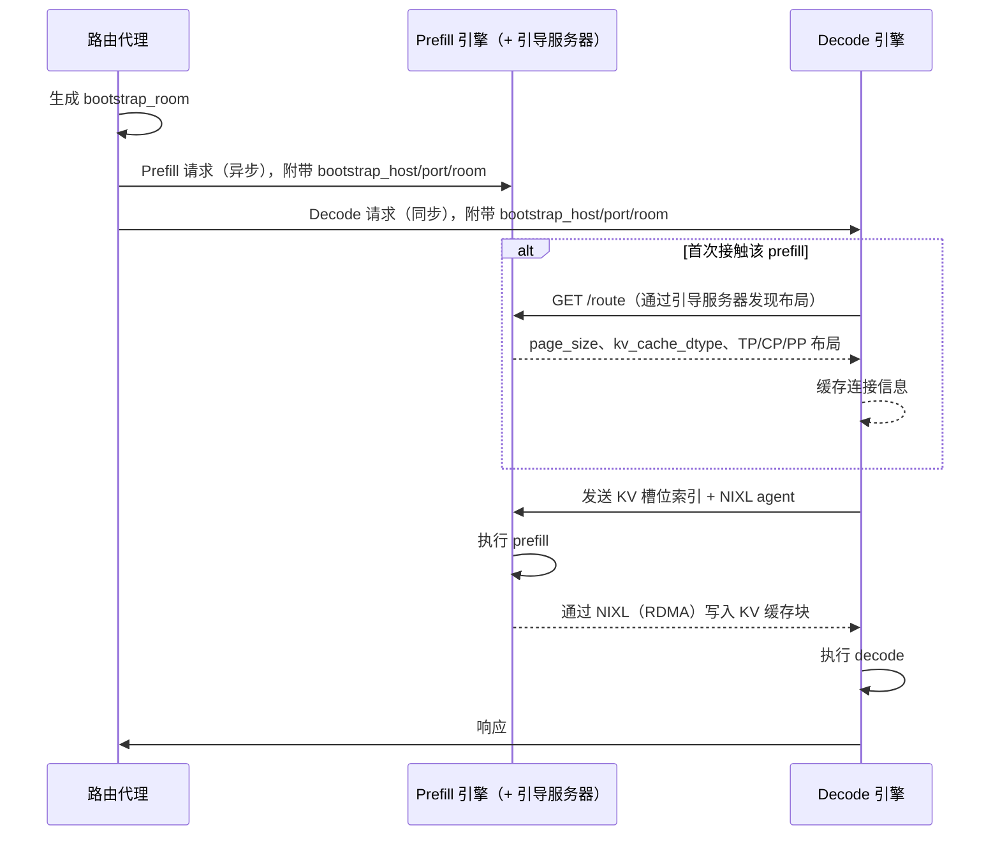
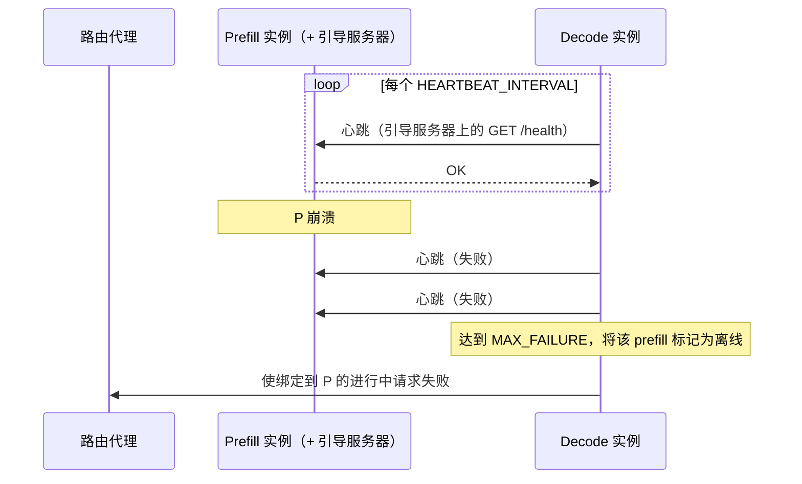
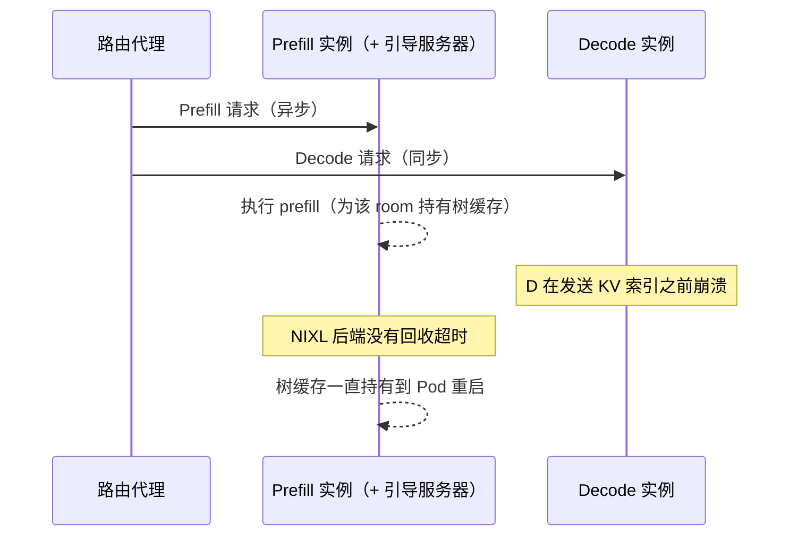

# 分离式服务：运维（SGLang）

虽然分离式服务能提供更优的性能，但它也带来了额外的运维复杂度，包括：

- [动态连接](#dynamic-connections)——当实例之间需要点对点 RDMA 连接时，如何动态增加或移除 P 和 D 实例
- [请求取消](#request-cancellation)——在分布式环境中请求终止时，如何释放各实例上的 KV 缓存
- [容错](#fault-tolerance)——如何确保崩溃不会引发级联故障，并且资源能被清理
- [发布](#rollouts)——如何对服务进行变更发布，例如更换 SGLang 镜像的版本

本页记录对 SGLang 模型服务器的这些常见运维流程有影响的架构考量。vLLM 的对应内容请参阅 [vllm.md](vllm.md)；关于 EPP 和路由代理 Sidecar 如何协调 P/D 请求的概览，请参阅[分离式服务](../../architecture/advanced/disaggregation/README.md)页面。

两种引擎都会为每一对 P/D 建立 NIXL（RDMA）连接，主要区别在于两端如何找到彼此、以及由哪一端搬运数据：vLLM 在没有中央协调者的情况下点对点协商连接，并由 decode 拉取 KV；而 SGLang 通过与每个 prefill 实例一起运行的引导（bootstrap）服务器完成对端发现，并由 prefill 把 KV 推送给 decode。

## 动态连接 {#dynamic-connections}

在生产环境中，模型服务器副本在服务运行期间被创建和销毁是很常见的。在分离式配置中，由于需要动态建立/销毁 P 与 D 工作节点之间的连接，动态增减副本变得更加复杂。

SGLang 通过在每个 prefill 实例上启动的引导服务器（默认端口 `8998`）来协调这一过程。对于每个请求，路由代理 Sidecar 会配对一个 P 和一个 D，并给两者相同的会合令牌；随后双方借助该引导服务器找到彼此，并在 Pod 之间直接进行 KV 传输，不经过 Sidecar 的请求路径。

### 扩容 {#scale-up}

新的 P 和 D 副本以惰性方式建立连接，无需预热步骤：第一个跨某一对 P/D 路由的请求会触发一次性的连接建立，后续请求复用该连接，因此新增的副本无需重启即可开始服务。

对于每个请求，路由代理 Sidecar（配置为 `--kv-connector=sglang`）会生成一个唯一的 `bootstrap_room` ID，把 `bootstrap_host`、`bootstrap_port` 和 `bootstrap_room` 注入到 prefill 和 decode 两个请求体中，异步（在后台 goroutine 中）发起 prefill 请求，同时同步发送 decode 请求。因此，decode 工作节点在开始协调之前不必等待 prefill 完成。

在引擎一侧：

- Prefill 实例运行一个暴露 `/route` 端点的引导服务器，并在启动时把自己的并行布局（TP/CP/PP rank、`page_size`、`kv_cache_dtype`）注册到其中。
- Decode 实例在首次接触某个 prefill 引导地址时，会通过 HTTP 从引导服务器的 `/route` 端点获取该 prefill 的并行信息并缓存起来。之后发往同一个 prefill 的请求复用缓存的连接，因此除了每个 prefill 自带的引导服务器之外，并没有维护全局状态的中央协调者。

请求流程如下：

#### 发现 {#discovery}

由于模型服务器实例是通过标准的 Kubernetes 选择器和标签加入 `InferencePool` 的，新的 prefill 和 decode 实例会在其 Pod 状态变为 `status: Running` 时被自动发现。同样使用 `llm-d.ai/role` 标签的取值（`prefill`、`decode`、`prefill-decode`）来过滤 P 和 D 工作节点。详情参见 [vllm.md#discovery](vllm.md#discovery)。

因此，可以在不重启、也无需借助任何专门服务发现平面进行协调的情况下，向运行中的分离式部署添加新副本。

### 缩容 {#scale-down}

SGLang 实例遵循与 vLLM 相同的 Kubernetes [Pod 终止流程](https://kubernetes.io/docs/concepts/workloads/pods/pod-lifecycle/#pod-termination)（Terminating 状态、从 `InferencePool` 中移除、可选的 preStop 钩子、`SIGTERM`、宽限期，最后是 `SIGKILL`）。对于**新请求**，正在终止的 Pod 会被自动从 `InferencePool` 中移除，因此不会有新流量被路由过去。

对于**进行中的请求**，请注意 SGLang 并没有提供类似 vLLM `--shutdown-timeout` 的优雅排空参数，因此运维人员不应指望进行中的请求会在终止期间被排空。为这些请求持有的 KV 缓存如何回收，取决于传输后端，详见下文。

#### 缩容 Decode 副本 {#scaling-down-decode-replicas}

移除某个 decode 副本时，分配给它的所有进行中 room 都会在 KV 传输完成之前被放弃。从 prefill 的视角看，这与 decode 崩溃没有区别，被持有的树缓存（tree cache）如何回收取决于传输后端（参见 [Decode 实例故障](#decode-instance-failure)）。

#### 缩容 Prefill 副本 {#scaling-down-prefill-replicas}

移除某个 prefill 副本时，decode 实例会通过心跳机制发现这一点（参见 [Prefill 实例故障](#prefill-instance-failure)）。绑定到该 prefill 的进行中请求会被标记为失败；一旦它离开 `InferencePool`，新请求就不会再被路由过去。

## 请求取消 {#request-cancellation}

鉴于推理请求计算量大、持续时间长，模型服务器支持“请求取消”：当客户端断开时，释放当前正在进行的请求。

在分离式部署中，这一点更加复杂，因为与一个请求关联的资源分布在 prefill 和 decode 两个实例上。使用 SGLang 时，路由代理 Sidecar 为客户端保持 decode 请求的连接，而 prefill 请求在后台异步运行。当客户端断开时：

- decode 实例中止进行中的请求，并释放其树缓存。
- prefill 实例在其 room 的 KV 传输进入终止状态后释放树缓存。在本指南所用的 NIXL 传输后端上，如果 decode 在*发起传输之前*就断开了，prefill 没有任何超时机制来回收它（见下方说明）。周期性的 `SGLANG_DISAGGREGATION_BOOTSTRAP_ENTRY_CLEANUP_INTERVAL`（默认 `120s`）只会从引导服务器中清除过期的簿记条目，而不会释放 GPU KV 缓存。

:::note
这与 vLLM 不同：vLLM 在中止时会发送显式的 `NIXL.send_notif`，以释放 prefill 一侧的 KV 缓存。在 NIXL 传输后端上，SGLang 没有对应的 prefill 侧中止信号：如果请求在 decode 已完成配对、但尚未发起传输时被取消，prefill 可能会一直持有该 room 的 KV 缓存，直到 prefill Pod 被重启。
这类似于 vLLM 中 `VLLM_NIXL_ABORT_REQUEST_TIMEOUT` 对应的滞留窗口，区别在于 vLLM 用一个超时（默认 `480s`）限定了它，而基于 NIXL 的 SGLang 没有。限定 prefill 侧回收的 `SGLANG_DISAGGREGATION_BOOTSTRAP_TIMEOUT` 是为 Mooncake 和 Mori 传输后端实现的，而不是 NIXL。
:::

## 容错 {#fault-tolerance}

在 llm-d 的分离式服务设计中，所有 D 实例都可以连接到所有 P 实例。这带来了一个关键的运维风险——如果系统不能容忍故障，工作节点的崩溃就有可能引发级联故障。

### Prefill 实例故障 {#prefill-instance-failure}

与 vLLM 不同——vLLM 不做存活检查，只有在某个请求的 NIXL `READ` 失败时才会发现 prefill 已失效——SGLang 的 decode 实例会通过心跳主动对 prefill 引导服务器做健康检查：

- `SGLANG_DISAGGREGATION_HEARTBEAT_INTERVAL`：对 prefill 引导服务器进行健康检查的间隔（默认 `5s`，最小值限定为 `2s`）。
- `SGLANG_DISAGGREGATION_HEARTBEAT_MAX_FAILURE`：连续多少次心跳失败后，将 prefill 服务器标记为离线（默认 `2`，最小 `1`）。

当一个原本健康的 prefill 服务器停止响应时，decode 实例会把它标记为离线，并让所有绑定到它的进行中请求失败（`KVPoll.Failed`），而不是一直挂起。作为标准 Pod 生命周期的一部分，发生故障的 prefill 工作节点 Pod 也会被置为 `status: Terminated`；由于 llm-d 利用 Kubernetes API Server 进行服务发现，在它回到 `status: Running` 之前，不会再有流量被路由到这个故障节点。通过这种方式，`llm-d` 隔离了 prefill 实例的故障。

### Decode 实例故障 {#decode-instance-failure}

虽然 decode 故障不太可能导致 prefill 实例崩溃，但存在 KV 缓存内存滞留在 prefill 上的风险，因为 prefill 会一直为某个 room 持有树缓存，直到它把 KV 写给 decode 且传输完成为止。

仍然存活、但在等待一个失败或缓慢的传输的 decode，会通过 `SGLANG_DISAGGREGATION_WAITING_TIMEOUT`（默认 `300s`）保护自己：如果在完成引导之后始终没有收到 KV 传输完成的信号，它会中止请求并释放自己的树缓存。prefill 一侧在 room 的传输进入终止状态后释放它——失败的 NIXL 传输会把 room 标记为 `KVPoll.Failed`，prefill 随即中止并释放树缓存。然而，如果 decode 在*发起传输之前*就死掉了，在 NIXL 后端上该 prefill room 永远不会进入终止状态。

:::warning
在本指南所用的 NIXL 传输后端上，如果某个 prefill room 的 decode 在发起传输之前就已经死掉，该 room 不会被自动回收；它会一直持有树缓存，直到 prefill Pod 被重启。限定这种滞留的 `SGLANG_DISAGGREGATION_BOOTSTRAP_TIMEOUT`（默认 `300s`）是为 Mooncake 和 Mori 传输后端实现的，而不是 NIXL。这与 vLLM 文档中记录的 decode 故障滞留情况类似，后者通过 `VLLM_NIXL_ABORT_REQUEST_TIMEOUT`（默认 `480s`）加以限定。
:::

## 发布 {#rollouts}

在分离式服务中，发布模型服务器的新版本（例如新的 SGLang 镜像或新的配置）需要格外小心，因为 NIXL 直接在 prefill 和 decode 的 GPU 显存之间搬运 KV 缓存。因此，任何可能被一起调度的 P 和 D 实例对之间，KV 缓存布局都必须一致。

SGLang 在建立连接时校验布局兼容性。当 decode 实例从引导服务器的 `/route` 端点获取 prefill 的信息时，会检查：

- **`page_size`**：不一致时抛出 `RuntimeError`（`Both servers must use the same --page-size value`）。
- **`kv_cache_dtype`**：不一致时抛出 `RuntimeError`（`Both servers must use the same --kv-cache-dtype value`）。

P 与 D 之间张量并行规模不一致是受支持的（decode 会解析 TP/CP/PP rank 映射），但对于非 MLA 模型，SGLang 会警告性能无法保证。

:::info
与 vLLM 一样，llm-d EPP 目前假定一个 `InferencePool` 内的所有 P 和 D 实例都是兼容的，可能把请求调度到任意一对实例上。由于不兼容的 `page_size` / `kv_cache_dtype` 组合会在建立连接时失败，建议通过创建新的 `InferencePool` 来发布模型服务器升级，而不是在同一个资源池中混用不同版本。使用 `Gateway` 部署时，可以通过修改 `HTTPRoute` 逐步把流量切换到新的 `InferencePool`。参见 [vllm.md#rollouts](vllm.md#rollouts)。
:::

## 调优参考 {#tuning-reference}

下表中的取值以环境变量的形式设置在模型服务器 Pod 上（引导端口由路由 Sidecar 读取）。

| 变量 | 默认值 | 所在端 | 控制内容 |
| --- | --- | --- | --- |
| `SGLANG_BOOTSTRAP_PORT`（Sidecar） | `8998` | Sidecar / prefill | Sidecar 指引 decode 工作节点访问的 prefill 引导服务器端口。必须与引擎的 `--disaggregation-bootstrap-port` 一致。 |
| `SGLANG_DISAGGREGATION_HEARTBEAT_INTERVAL` | `5s` | decode | decode 工作节点对 prefill 引导服务器做健康检查的频率（最小 `2s`）。调低可以更快发现失效的 prefill。 |
| `SGLANG_DISAGGREGATION_HEARTBEAT_MAX_FAILURE` | `2` | decode | 连续多少次心跳失败后将 prefill 标记为离线（最小 `1`）。 |
| `SGLANG_DISAGGREGATION_WAITING_TIMEOUT` | `300s` | decode | decode 等待 KV 传输完成信号的时长，超时后中止并释放其树缓存。在 NIXL 后端上生效。 |
| `SGLANG_DISAGGREGATION_BOOTSTRAP_TIMEOUT` | `300s` | prefill | prefill 等待 decode 发来 KV 索引的时长，超时后中止并释放其树缓存。仅为 Mooncake 和 Mori 后端实现——**不适用于** NIXL。 |
| `SGLANG_DISAGGREGATION_BOOTSTRAP_ENTRY_CLEANUP_INTERVAL` | `120s` | prefill | 引导服务器清除过期路由簿记条目的频率。不会释放 GPU KV 缓存。 |
