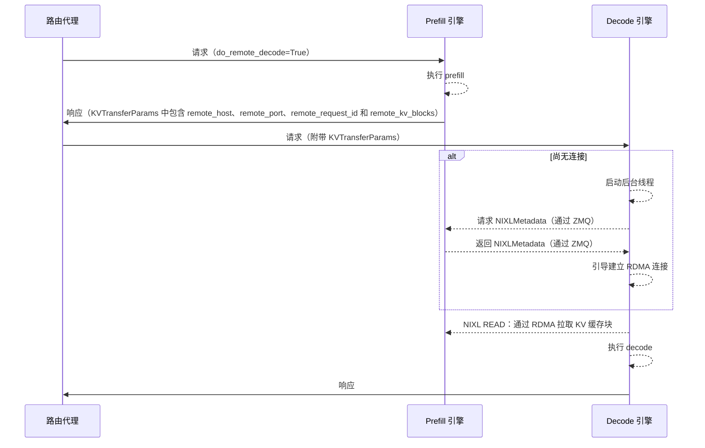
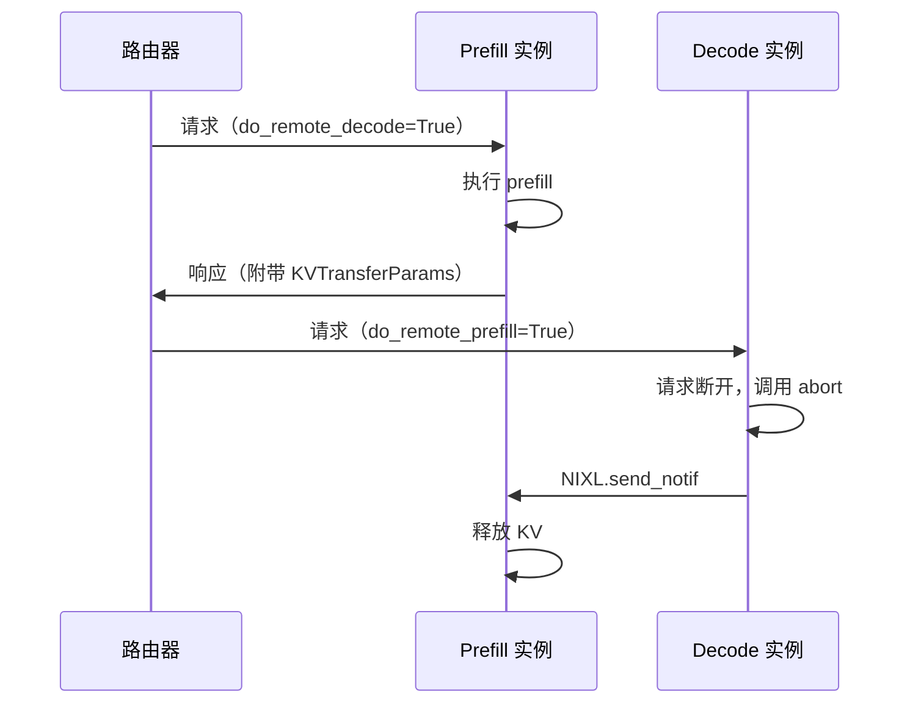
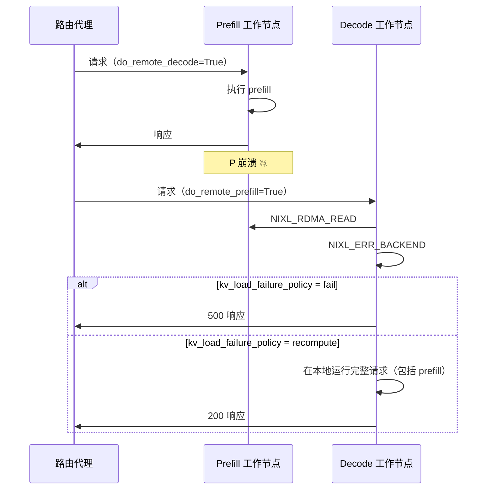
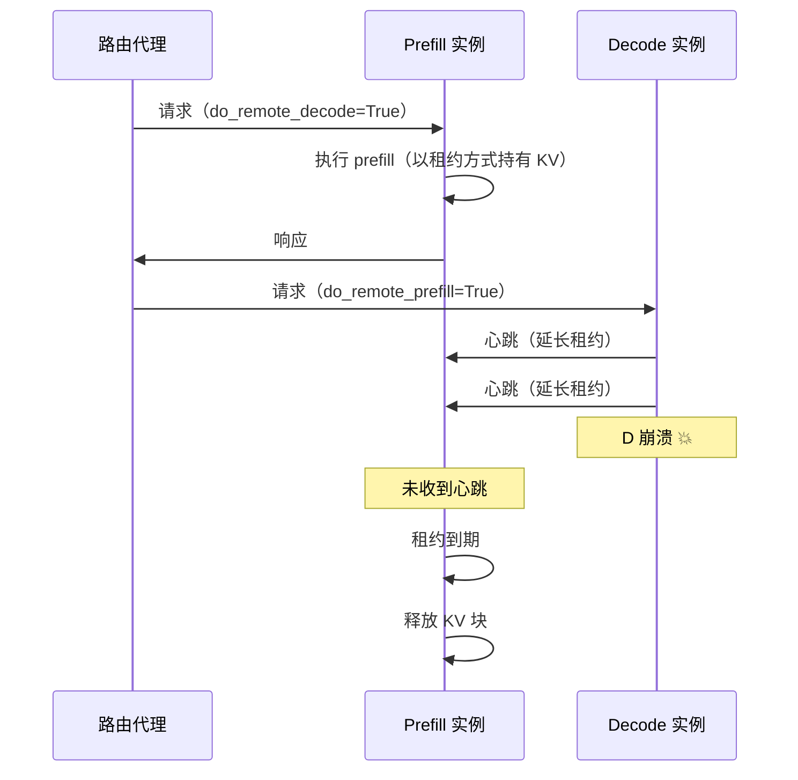

# 分离式服务：运维（vLLM）

虽然分离式服务能提供更优的性能，但它也带来了额外的运维复杂度，包括：

- [动态连接](#dynamic-connections)——当实例之间需要点对点 RDMA 连接时，如何动态增加或移除 P 和 D 实例
- [请求取消](#request-cancellation)——在分布式环境中请求终止时，如何释放各实例上的 KV 缓存
- [容错](#fault-tolerance)——如何确保崩溃不会引发级联故障，并且资源能被清理
- [发布](#rollouts)——如何对服务进行变更发布，例如更换 vLLM 镜像的版本
- [NIXL 连接器的已知问题与局限](#known-nixl-connector-issues-and-limitations)——NIXL 连接器当前的缺口和缺陷，需在规划中予以规避

本页记录影响这些常见运维流程的架构考量。

## 动态连接 {#dynamic-connections}

在生产环境中，模型服务器副本在服务运行期间被创建和销毁是很常见的。在分离式配置中，由于需要动态建立/销毁 P 与 D 工作节点之间的连接，动态增减副本变得更加复杂。

vLLM 通过 NIXL 的 API 支持这项功能，这些 API 允许动态增加和移除连接。

### 扩容 {#scale-up}

为了创建新连接，vLLM 会在 D 和 P 实例之间执行一次“NIXL 握手”来建立 RDMA 连接。这是一个代价相对较高的操作（约 5 秒），每一对实例只需执行一次，之后的所有请求都复用已有的连接。llm-d 采用“动态惰性”的发布策略，从而无需一个维护全局状态的集中式引导服务器。

其工作方式如下：



- Prefill 实例运行一个后台服务线程来处理对 `NIXLMetadata` 的请求。P 实例处理完成后，会构造 `KVTransferParams`，并在响应体中包含（除其他内容外）`remote_host=VLLM_SIDE_CHANNEL_HOST`（Pod IP）和 `remote_port=VLLM_SIDE_CHANNEL_PORT`。
- Decode 实例收到附带 `KVTransferParams` 的请求；如果与远端 P 工作节点之间还没有连接，它会启动一个后台线程获取 `NIXLMetadata` 并建立 RDMA 连接。这一操作不会阻塞核心引擎的执行，其他请求可以照常进行。

#### 发现 {#discovery}

由于模型服务器实例是通过标准的 Kubernetes 选择器和标签加入 `InferencePool` 的，新的 prefill 和 decode 实例会在其 Pod 状态变为 `status: Running` 时被自动发现。

因此，可以在不重启、也无需借助任何专门服务发现平面进行协调的情况下，向运行中的分离式部署添加新副本。

### 缩容 {#scale-down}

Kubernetes 中有一套明确定义的 [Pod 终止流程](https://kubernetes.io/docs/concepts/workloads/pods/pod-lifecycle/#pod-termination)：

- **触发终止**：Pod 的状态变为 **Terminating**。
- **更新 `InferencePool`**：该 Pod 被从关联 `InferencePool` 的端点列表中移除，阻止新流量被路由到它。（注：对于标准 Kubernetes 对象，这相当于从 Service 中移除）
- **PreStop 钩子**：如果定义了，执行 preStop 钩子。
- **SIGTERM 信号**：Kubernetes 向每个容器的主进程发送 SIGTERM 信号。
- **终止宽限期**：Pod 有一段固定的时间（默认 30 秒）来优雅关闭。如果到期仍未终止，会发送 SIGKILL 强制终止。

对于**新请求**，实例会被自动从 `InferencePool` 中移除，因此不会有新流量被路由到正在终止的 Pod。

对于**运行中的请求**，可以配置 vLLM 如何处理 `SIGTERM`：

- 默认情况下，vLLM 立即中止（`abort`）现有请求并终止。这会使运行中的请求以错误状态码失败。
- 可以为 vLLM 配置 `--shutdown-timeout N`。设置后，vLLM 会捕获 `SIGTERM`，并在 `N` 秒内排空当前正在运行的请求。超时后，它会中止（`abort`）所有仍在进行中的请求，并返回错误码。

#### 缩容 Decode 副本 {#scaling-down-decode-replicas}

由于 prefill 实例会一直持有 KV，直到 decode 实例把它们拉走，因此在缩容 decode 实例时，确保 prefill 实例上的 KV 被释放非常重要。

在 vLLM 中，无论是否设置了 `--shutdown-timeout`，关闭过程中请求都会被中止（`abort`）。作为 `abort` 流程的一部分，尚未开始 KV 传输的 decode 实例会向远端 prefill 实例发送 NIXL 通知以释放这些块。因此，缩容 decode 副本总能释放 P 实例上的请求资源。

#### 缩容 Prefill 副本 {#scaling-down-prefill-replicas}

缩容 prefill 副本时，decode 实例可能会尝试从已终止的远端 prefill 实例拉取 KV 块。

:::warning
目前，无论是否设置 `--shutdown-timeout`，都无法把 prefill 实例的关闭推迟到所有块都被取走之后。vLLM 正在开发这项功能。
:::


因此，缩容 prefill 会导致 decode 实例上进行中的请求加载 KV 失败。为避免 KV 传输失败返回错误码，可以为 decode 实例配置 `kv_load_failure_policy=recompute`，在 decode 实例上重新计算 prefill。

## 请求取消 {#request-cancellation}

鉴于推理请求计算量大、持续时间长，vLLM 等模型服务器支持“请求取消”：当客户端断开时，释放当前正在进行的请求。

在分离式部署中，这项功能更加复杂，因为与一个推理请求关联的资源分布在多个服务器上（P 实例会一直持有 KV 缓存，直到被 D 实例取走）。因此，如果请求在 D 实例上仍处于“进行中”、但 KV 传输尚未发生时被取消，我们需要确保 P 实例上的资源被正确清理。

llm-d 在 vLLM 现有的请求取消机制之上实现了这一功能。当请求在 vLLM 中断开时，会触发 `abort` 代码路径，清理运行中的资源。当带有 `do_remote_prefill=True` 的请求被中止时，vLLM 会发送一条 NIXL 通知消息，指示远端 prefill 实例为被取消的请求释放 KV 缓存。



:::warning
存在一个小窗口，在此期间请求取消不会触发 P 实例上的 KV 释放。如果请求在 P 工作节点上已完成、但尚未到达 D 工作节点的调度器时断开（例如在请求位于路由代理内部时断开），D 实例根本不知道这个请求，因此无法释放 P 工作节点上的远端块。在这种情况下，KV 块会在 P 实例上一直保留到租约到期（`kv_lease_duration`，默认 30 秒），届时会被自动释放。
:::


## 容错 {#fault-tolerance}

在 llm-d 的分离式服务设计中，所有 D 实例都与所有 P 实例相连。这带来了一个关键的运维风险——如果系统不能容忍故障，工作节点的崩溃就有可能引发级联故障。

### Prefill 实例故障 {#prefill-instance-failure}

Prefill 实例崩溃是一种关键的故障模式，因为 D 实例会在不做任何存活检查的情况下，尝试从已不再运行的 P 实例拉取 KV。由于每个 D 工作节点都与每个 P 工作节点相连，在 D 工作节点上处理这类错误至关重要。

vLLM 基于 NIXL 的错误处理功能来应对 prefill 实例故障。当尝试执行 READ 并失败时，NIXL 返回 `NIXL_ERR_BACKEND` 等错误码。vLLM 捕获该错误，并按照 [`kv_load_failure_policy`](https://docs.vllm.ai/en/stable/features/nixl_connector_usage/?h=nixl#kv-load-failure-policy) 进行处理：

- **fail（默认，推荐）**：KV 加载失败时立即以错误使请求失败。这样可以避免在 decode 实例上重新计算 prefill 工作，从而防止性能下降。
- **recompute**：在 decode 实例本地重新计算失败的块。这可能导致 decode 实例的性能抖动，因为被调度的 prefill 会延迟并干扰其他 decode。此外，配置了低延迟优化的 decode 实例（例如 Wide EP 部署中的 DeepEP LL）可能会显著变慢。



作为标准 Pod 生命周期的一部分，发生故障的 prefill 工作节点 Pod 会被自动置为 `status: Terminated` 状态。由于 llm-d 利用 Kubernetes API Server 进行服务发现，在该 Pod 重启并回到 `status: Running` 状态之前，不会再有流量被路由到这个故障节点。

通过这种方式，`llm-d` 隔离了 prefill 实例的故障。

### Decode 实例故障 {#decode-instance-failure}

虽然 D 实例故障不太可能导致 P 实例崩溃（因为 P 实例从不发起 RDMA 操作），但面临的挑战是如何确保 P 实例上的 KV 缓存内存不会被“滞留”（因为 P 实例会一直持有 KV 缓存，直到 D 实例显式地把它拉走）。

vLLM 通过一套**基于租约的 KV 块管理**机制解决这个问题。prefill 完成后，P 以初始租约 `kv_lease_duration`（默认 `30s`）持有 KV 块。当请求在 D 实例上排队或运行时，D 的调度器会定期向 P 发送心跳通知，每次把租约延长 `lease_extension = kv_lease_duration * 2 // 3`（默认 `20s`）。如果 D 崩溃（或失去响应），心跳停止，P 会在最后一次租约延期到期时自动释放 KV 块——最多在最后一次心跳之后 `lease_extension` 秒。

这种方式在保证最坏情况下块持有时间较短的同时，又不会在 D 实例负载很重时冒过早淘汰块的风险——只要 D 存活，心跳就会让租约一直保持有效。



`kv_lease_duration` 可以通过 `kv_connector_extra_config` 配置：

```bash
--kv-transfer-config '{"kv_connector_extra_config": {"kv_lease_duration": 10}}'
```

:::note
基于租约的 KV 块 TTL 需要 **vLLM v0.22.0** 或更新版本。
在更早的版本中，vLLM 通过 `VLLM_NIXL_ABORT_REQUEST_TIMEOUT`（默认 `480s`）采用固定超时的方式：无论 D 实例是否仍然存活，P 实例只有在该超时到期后才会释放滞留的 KV 块。这使最坏情况下的持有时间非常长，而缩短超时又会在 D 实例负载很重时带来过早淘汰的风险。
:::


## 发布 {#rollouts}

在分离式服务中，发布模型服务器的新版本（例如新版本的 vLLM 或新的配置）需要格外小心，因为 prefill-decode 实例对之间需要相互通信来执行 KV 传输操作。举个例子，vLLM 有多种注意力内核实现，它们的 KV 缓存布局可能略有不同——由于 NIXL 直接从远端实例的 GPU KV 缓存内存中拉取 KV，我们需要确保两端的布局一致。

默认情况下，vLLM 会在 NIXL 握手期间检查[实例之间的兼容性](https://github.com/vllm-project/vllm/pull/29503)，如果请求被调度到不兼容的 Pod 上，就会让请求失败。也可以通过以下方式关闭兼容性检查：

```bash
--kv-transfer-config '{"kv_connector_extra_config": {"enforce_handshake_compat": false}}'
```

:::info
llm-d EPP 目前假定一个 `InferencePool` 内的所有 P 和 D 实例都是兼容的，因此可能把请求调度到任意一对 P 和 D 实例上。所以目前建议在升级模型服务器时创建一个新的 `InferencePool`。使用 `Gateway` 部署时，可以通过修改 `HTTPRoute` 逐步把流量切换到新的 `InferencePool`。
:::


## NIXL 连接器的已知问题与局限 {#known-nixl-connector-issues-and-limitations}

除上述运维流程外，NIXL 连接器目前还存在几个值得在规划部署时考虑的缺口。

### 不支持 Prefill TP > Decode TP {#prefill-tp--decode-tp-is-not-supported}

:::warning
对于大多数模型架构，**不支持 Prefill TP > Decode TP**。**NixlConnector** 只支持扇出方向（decode TP ≥ prefill TP，例如 prefill TP=1 → decode TP=4）。这是 vLLM 源码中刻意设置的保护，而不是缺陷——请始终保持 decode TP ≥ prefill TP。
:::


对于既不是 **MLA** 也不是基于 **Mamba/状态空间**的任何模型，反方向（prefill TP > decode TP，例如 prefill TP=8 → decode TP=4）明确不受支持：

```python
# num_kv_heads > tp_size with P_TP > D_TP not supported for non-mamba.
# Mamba models can have replicated FA KV with tp_ratio < 0.
# MLA models do not need to handle kv replication.
if not self.use_mla and not self._has_mamba:
   assert not (
       tp_ratio < 0 and self.transfer_topo.is_kv_replicated(remote_engine_id)
   )
```

来源：`vllm/distributed/kv_transfer/kv_connector/v1/nixl/base_worker.py`，函数 `_validate_remote_agent_handshake`

- v0.26.0：[第 1690-1696 行](https://github.com/vllm-project/vllm/blob/v0.26.0/vllm/distributed/kv_transfer/kv_connector/v1/nixl/base_worker.py#L1690-L1696)
- v0.25.0：[第 1619-1625 行](https://github.com/vllm-project/vllm/blob/v0.25.0/vllm/distributed/kv_transfer/kv_connector/v1/nixl/base_worker.py#L1619-L1625)（逻辑相同，并非版本回退）

触发这条路径会使 decode 引擎因 `AssertionError` 崩溃。vLLM 失败清理处理函数（`_handle_failed_transfer`）中的一个相关缺陷，常常使其表现为 `IndexError: list index out of range`，让人误以为是一个普通的连接器缺陷，而不是针对不受支持拓扑的保护。

GPU 总数（TP × 副本数）以及两侧各自的副本数都不受此约束影响——只有处理某个请求的那一对 prefill/decode 引擎之间 TP 比例的方向才有关系。

### Prefill Pod 重启后 NIXL agent 缓存过期 {#stale-nixl-agent-cache-after-a-prefill-pod-restart}

:::warning
**prefill Pod 重启后，decode 一侧过期的 NIXL agent 缓存**可能导致 decode 段错误（segfault）（[vllm-project/vllm#49238](https://github.com/vllm-project/vllm/issues/49238)，尚未关闭），或者让它在长达一小时内默默地对着一个已失效的引擎提供服务。在下面的修复进入官方镜像之前，请主动重启所有曾连接到已重启 prefill Pod 的 decode 副本，而不要依赖 TTL 到期。
:::


如果在 decode 仍缓存着某个 prefill Pod 的 NIXL agent 句柄时该 prefill Pod 重启了，decode 可能会段错误，或者（在下面提到的 NIXL 侧修复之后）默默地继续使用已失效引擎的过期缓存 agent/rkey 条目。在引擎 ID 被固定/稳定的情况下，decode 要等到 `engine_ttl` 到期（默认最长一小时）才会发现 prefill 引擎已经不在了，在此之前（或在 decode Pod 被重启之前），所有路由到该 decode 副本的请求都会失败。

当 decode *没有*段错误时，它会尝试对过期的 agent 执行 NIXL RDMA 读取，并以 `NIXL_ERR_BACKEND` 失败——与 [Prefill 实例故障](#prefill-instance-failure)中描述的错误路径相同。随后 vLLM 应用 `kv_load_failure_policy`（[来源](https://github.com/vllm-project/vllm/pull/50047)）：

- **`recompute`**：decode 会默默回退为自己执行 prefill，只为失败的传输记录一行错误日志。客户端永远不会看到失败的请求，因此这只会表现为该 decode 副本的吞吐/延迟退化，而不是错误——比直接失败更难察觉。
- **`fail`（默认）**：请求以 500 响应失败，至少会让调用方察觉到问题。

在 `engine_ttl` 到期之前，落到该 decode 副本上的每个请求都会重复“读取失败然后重新计算”的循环，因此性能损失会一直持续，而不会在第一次失败后消失。

**修复状态：**

- NIXL 层面的段错误已在上游修复：[ai-dynamo/nixl#1986](https://github.com/ai-dynamo/nixl/pull/1986)（约 2026-07-29 合并），改为返回干净的断开连接错误而不是崩溃。
- vLLM 侧的修复 [vllm-project/vllm#50047](https://github.com/vllm-project/vllm/pull/50047)，会在检测到 prefill 对端已不存在时立即使 decode 缓存的引擎状态失效，而不是等到 TTL 到期。

这两个修复目前都还没有进入任何已发布的 vLLM 镜像（包括 nightly），因为 vLLM 固定了一个确切的 NIXL 版本，而 NIXL 的修复是在最新发布的 NIXL 版本（v1.3.2，2026-07-24）之后才合并的。
