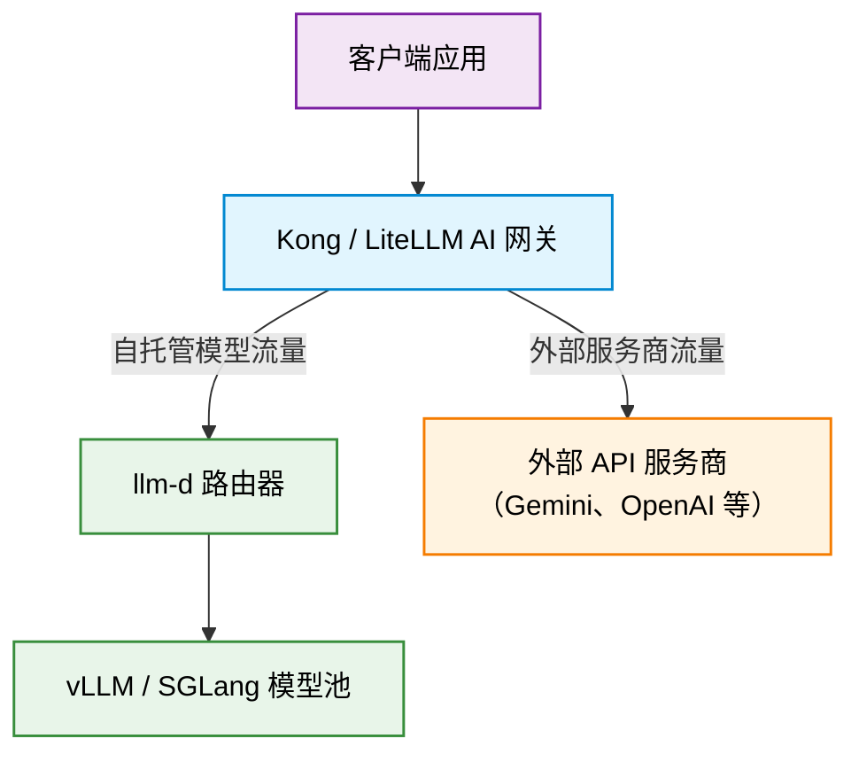

# 对接外部 API

本节介绍如何在 **llm-d** 之上部署 API 网关或代理层，统一管理发往自托管 LLM 工作负载以及第三方外部模型 API（如 Google Gemini、OpenAI 或 Anthropic）的流量。

在 LLM 基础设施前部署一个统一的代理，你可以：

- **集中管理 API 密钥和 Secret**：把外部服务商的密钥安全地存放在 Kubernetes Secret 中，而不是分发给客户端应用。
- **提供统一的、兼容 OpenAI 的接口**：让客户端应用在自托管的 llm-d 模型端点与外部 SaaS LLM 服务商之间无缝切换。
- **执行安全与限流策略**：在单一入口处实施企业级治理、认证、token 预算控制和日志记录。

---

## 架构概览 {#architecture-overview}

在两种配置中，代理都充当唯一的外部或集群内入口。针对自托管模型的请求被直接路由到 **llm-d 优化基线**基础设施，而针对外部模型的请求则经过认证后转发给云 API 服务商。

### 与 llm-d 的集成模式 {#integration-modes-with-llm-d}

两份指南都支持通过以下任一方式把外部 API 代理连接到 **llm-d**：

1. **网关模式（默认且推荐）**：连接到 Kubernetes Gateway 的 IP 或端点，利用 llm-d 完整的 Gateway API Inference Extension（GAIE）能力和路由管理。
2. **独立模式（可选）**：直接连接到 `optimized-baseline-epp` Service 端点（`http://optimized-baseline-epp...svc.cluster.local:80/v1`），绕过 Kubernetes Gateway，在集群内直接路由。

---

## 部署指南 {#deployment-guides}

选择一份指南开始部署：

- **[LiteLLM Proxy 指南](./litellm.md)**：部署带 PostgreSQL 的 LiteLLM，用于虚拟 API 密钥管理、用户花费跟踪、预算上限以及多服务商路由。
- **[Kong AI Gateway 指南](./kong.md)**：使用 Kubernetes Gateway API 和自定义资源（`KongPlugin`、`HTTPRoute`），以无数据库（DB-less）模式部署 Kong，实现高性能路由。
