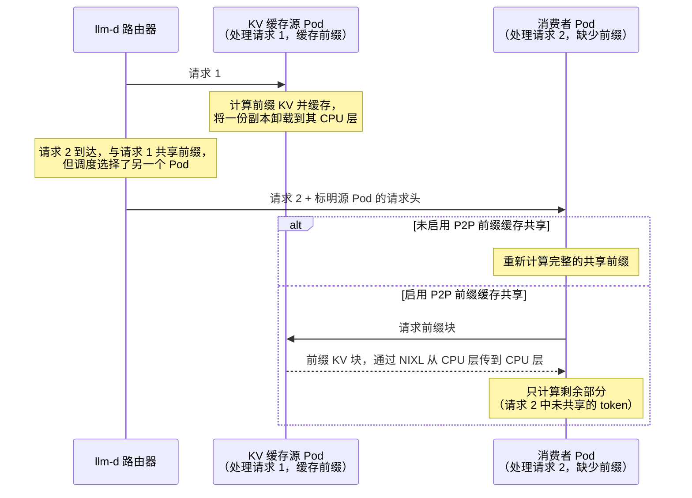

# [实验性] 启用 P2P 前缀缓存共享

前缀缓存是每个 Pod 独有的，但其内容往往是整个集群通用的：共享的系统提示词、常用文档、会话历史。前缀感知路由会把每个请求发送到缓存了其前缀的 Pod，但路由并不总能跟随缓存：热门前缀的所属 Pod 可能已经饱和，工作集可能超出任何单个 Pod 的容量，会话也可能被重新均衡。这些请求会重新计算对等节点上已经存在的 KV 张量。

P2P 前缀缓存共享弥补了这一缺口：模型服务器从对等节点的 CPU 卸载层拉取已缓存的前缀 KV 块，而不是重新计算。传输通过 NIXL 在 CPU 与 CPU 之间进行，完全不会触及源 Pod 的 GPU，因此响应一次拉取不会占用源 Pod 的 prefill 能力。

当一个请求与之前的某个请求共享前缀、但被调度到不同的 Pod 时，就会触发拉取。只要两个请求以相同的 token 开头，它们就共享前缀：例如对话的下一轮、针对同一文档的另一个问题、基于同一系统提示词的另一个会话。第一个请求所在的 Pod 是 **KV 缓存源（source）**：它计算了该前缀，并在其 CPU 层保存了一份副本。当路由器把共享前缀的请求调度到另一个 Pod 时，会在请求上标明源 Pod，而被调度的 Pod——即**消费者（consumer）**——会拉取前缀而不是重新计算：

:::info
P2P 前缀缓存共享建立在[分层前缀缓存](tiered-prefix-cache.md)路径之上：对等节点从其 CPU 卸载层响应拉取请求。随附的配置在每个对等节点上使用相同的 `--block-size`、`PYTHONHASHSEED` 和张量并行布局。其他布局需要兼容的对等会话指纹；指南中说明了张量并行和 model-runner 方面的约束。CPU 层的大小应足以保留有用的块；将其设置得比每个 Pod 的 GPU KV 缓存更大是指南推荐的起点，而不是正确性要求。[指南的最佳实践](https://github.com/llm-d/llm-d/tree/v0.10.0/guides/p2p-kv-cache-sharing#best-practices)介绍了每项要求、对应的容量规划规则及其故障模式。
:::

## 何时有收益 {#when-it-pays}

重新计算的成本随前缀长度增长。在实测的 H200/RDMA 环境中，CPU 到 CPU 的拉取耗时也随前缀长度增长，但增长要慢得多。对于 `openai/gpt-oss-120b`，在 2,048 到 49,152 个 token 的所有测量点上，拉取都更快。交叉点取决于具体的模型、硬件和传输方式。只有当选中的源比被调度的 Pod 至少多持有 `minCachedTokenDelta` 个前缀 token 时，路由器才会请求拉取，因此请在目标部署上校准该值。

拉取是否有帮助，还取决于其前面的放置策略：

- **归属稳定且无竞争时**：前缀感知路由本身就避免了传输。本地命中比拉取更便宜，因此不会触发拉取。
- **热门前缀使其所属 Pod 饱和，或工作集超出缓存容量时**：负载感知放置加上拉取，可以让整个集群提供相同的内容。在预热的 16 Pod 文档问答基准测试中，这比前缀亲和路由的 p99 TTFT 好 1.5 倍，吞吐量高 35%。
- **GPU KV 容量本身就是瓶颈时**：把缓存集中放置可以更高效地利用容量。同一 Pod 上并发的相同前缀请求共享一份块副本；而分散放置时，无论前缀是拉取还是重新计算，每个 Pod 都要付出一份副本的代价。

指南默认采用前缀亲和加拉取作为通用配置。当大量并发会话争抢其所属 Pod 时，改用负载感知放置加拉取。两种场景都在[基准测试报告](https://github.com/llm-d/llm-d/tree/v0.10.0/guides/p2p-kv-cache-sharing/benchmark-results/gpt-oss-120b-h200.md)中进行了测量。

## 部署 {#deploy}

清单文件、验证关卡和分步部署说明请参阅 [P2P KV 缓存共享指南](https://github.com/llm-d/llm-d/tree/v0.10.0/guides/p2p-kv-cache-sharing)。

## 架构 {#architecture}

1. **模型服务器 Pod 发布 KV 缓存事件**，并运行带有 CPU 层和 P2P 二级层的 vLLM `OffloadingConnector`：每个 Pod 既把计算出的 KV 卸载到 CPU，也向对等节点提供这些 KV。
2. **路由器根据 KV 事件构建精确的前缀索引**（即[精确前缀缓存路由](precise-prefix-cache-routing.md)机制），从而知道哪些 Pod 持有哪些前缀块。
3. **`p2p-source-producer` 选择源**：在缓存前缀最长者的一个索引块范围内的 CPU 层持有者中进行选择，并通过加权避免把拉取集中到一个有排队的源上。调度完成后，只有当该源比负责计算的 Pod 至少领先 `minCachedTokenDelta` 个 token 时，它才会设置 KV 缓存源请求头。
4. **路由 Sidecar 根据请求头注入 `kv_transfer_params.remote_kv_source`**，引擎随后通过 NIXL 从对等节点的 CPU 层拉取前缀块。命中会像普通缓存命中一样加载；查找失败则报告为未命中，由被调度的 Pod 在本地计算缺失的前缀。

在 P/D 分离模式下，prefill 工作节点是拉取的消费者，因为它负责计算提示词的 KV。decode 工作节点可以作为源，提供保留在其 CPU 层中的已生成会话历史。prefill 完成后，常规的 NIXL P/D 路径会把请求的 KV 传输到选定的 decode 节点。

## 延伸阅读 {#further-reading}

- [P2P KV 缓存共享指南](https://github.com/llm-d/llm-d/tree/v0.10.0/guides/p2p-kv-cache-sharing)——清单文件、验证关卡、基准测试。
- [基准测试报告：H200 上的 gpt-oss-120b](https://github.com/llm-d/llm-d/tree/v0.10.0/guides/p2p-kv-cache-sharing/benchmark-results/gpt-oss-120b-h200.md)——交叉点、共享前缀池、文档问答。
- [基准测试报告：H200 上的 GLM-5.2](https://github.com/llm-d/llm-d/tree/v0.10.0/guides/p2p-kv-cache-sharing/benchmark-results/glm-5.2-h200.md)——C64 策略对比、四组对照观测以及拉取机制的证据。
- [分层前缀缓存](tiered-prefix-cache.md)——P2P 用于提供数据的卸载层。
- [精确前缀缓存路由](precise-prefix-cache-routing.md)——用于选择拉取源的索引。
